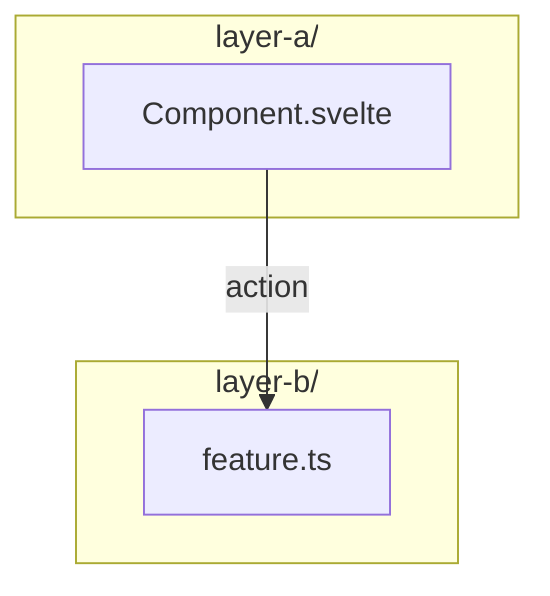

# Architecture: &lt;Component Name&gt;

> One-sentence summary of what this component does and where it is active
> (pages, layers, runtime). Keep it under ~40 words. End with the standard scope note:
> "Diagrams depict relationships, structure, and boundaries — no implementation details."

<!--
  ! MANDATORY TEMPLATE — source of truth: skill "arch-docs" (_template.md reference).
  ! Project instances live at docs/architecture/_template.md — generated from it.
  ! Every component doc MUST contain all sections marked [REQUIRED], in this order.
  ! Sections marked [OPTIONAL] may be omitted when not applicable — state why in one line.
  ! The docs gate (scripts/check-docs.mjs) validates structure and the Verified footer.
  ! Copy this file, replace content, keep the section order.
-->

## Component Structure [REQUIRED for feature docs]

<!-- flowchart showing the component's place in the system (gui + store + core + DOM,
     or the project's equivalent layers). Rules:
     - Every node label is a REAL file name, component name, or DOM selector from src/
       (grep-verify before writing — never invent names).
     - Selectors/ids that mark the component's external boundary belong in the diagram
       (the project's INDEX.md legend defines what counts as architecture here).
     - Every arrow has a label describing the relationship intent.
     - One diagram per section; the section heading names what the diagram answers. -->

## &lt;Behavior Section(s)&gt; [REQUIRED ≥1]

<!-- One or more sections explaining the mechanism: data flow, decision flow,
     runtime order. Use the diagram type that fits: flowchart for structure,
     sequenceDiagram for runtime order (boot, toggle, restore), classDiagram for types.
     Cross-cutting rationale lives in an ADR (docs/adr/NNNN-*.md) — link it here
     instead of duplicating. -->

## Scope Boundaries [REQUIRED for feature docs]

<!-- Two subgraphs: "Supported" and "Deliberately not supported" (reason inline:
     fragile, over-engineering, out of scope, ...). This section is the primary
     anti-feature-creep contract for future sessions — keep it complete and honest. -->

## References [REQUIRED]

<!-- File paths for humans and agents to jump from doc to code. Paths are validated
     by the docs gate — repo-relative, no wildcards. -->

- Feature: `src/...`
- Tests: `tests/...`
- Related docs: `docs/architecture/...`

<!-- [OPTIONAL] Deviation-from-plan note: when the implementation deviated from a plan
         doc (docs/plans/*.md), record it here — the plan itself stays untouched.

Verified: YYYY-MM-DD — against `src/...` @ commit &lt;hash or "working tree"&gt;
<!-- ! The Verified footer is MANDATORY. Update it whenever the doc is verified against
<!-- ! code. A stale date surfaced by the docs gate is a re-verify trigger, not a
<!-- ! hard failure — unless the component was touched in the same change.
