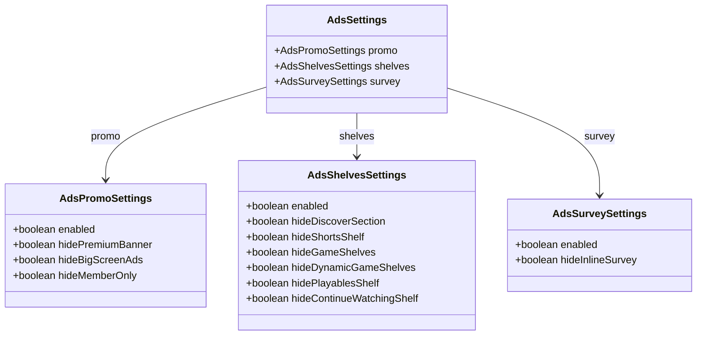
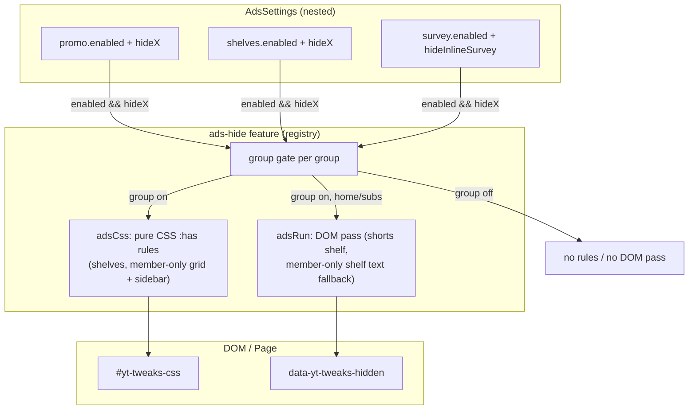
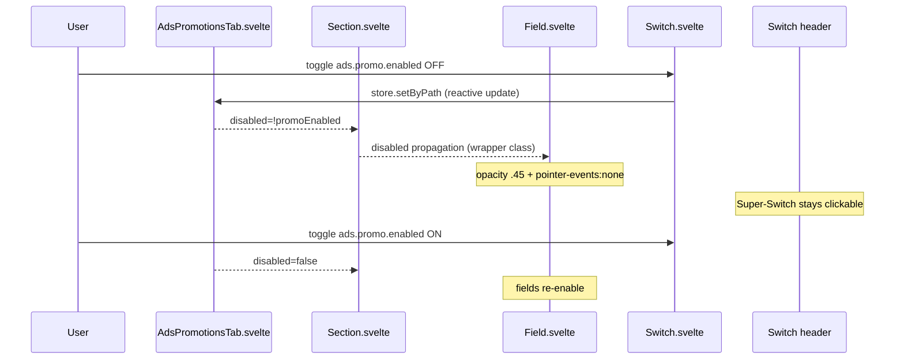

# Architecture: Ads & Promotions Hiding

> Three-group ads/promo hiding architecture. Each group has its own Super-Switch (`enabled`) that
> gates both the UI (Fields grey out when the group is off) and the feature (CSS rules + DOM pass
> are skipped for a disabled group). Diagrams depict relationships, structure, and boundaries — no
> implementation details.

## Component Structure: Settings Groups



## Group-Gate → CSS/Run Flow



## Member-Only Detection (Grid Items + Watch Sidebar)

Member-only videos ("Nur für Kanalmitglieder" / "Members only") are hidden via pure CSS `:has()`
on the badge class `ytBadgeShapeCommerce` — the badge `badge-shape` inside the lockup metadata
carries it in the live lockup structure (user-reported DOM, 2026-10-24). Two rules:

- **Grid surfaces**: `ytd-rich-item-renderer:has(...)` — hides the whole outer grid item so no
  empty grid cell remains (the startpage row-count override stays intact).
- **Watch sidebar**: `ytd-watch-next-secondary-results-renderer yt-lockup-view-model:has(...)` —
  sidebar items are bare `yt-lockup-view-model` elements (no rich-item wrapper), so the lockup
  itself is the outermost hideable node; scoped to the sidebar container.

The class match is **content-locale-independent** (works for every UI language). It replaces the
former DOM pass that probed `badge-style-type-members-only` — a dead class (fixture probe-count 0
since 2026-08-23) the pass never matched, mirroring the `ytBadgeShapePromoted` precedent used by
`hideBigScreenAds`. Fails safe: no Commerce badge → no match → nothing hidden. Drift mode is
over-hide if YouTube ever reuses the Commerce badge class for non-member badges — live-verify
after rollout.

The DOM pass retains only the member-only **shelf** text-match fallback (`adsText` in
`locale.ts`, scans rich-sections/brand shelves) and the Shorts-shelf title pass.

## UI Disable (Group Super-Switch Off)



**Single-feature boundary**: the `ads-hide` feature stays a **single registered feature**
(`settingsPath: "ads"`) — group gating is internal to `adsCss`/`adsRun`, not three separate
features. Migration: `loadSettings` detects the pre-revisit flat `ads.{hideX}` shape (booleans
directly under `ads`) and maps them into the three groups with `enabled: true` (one-time,
deletes old keys). Already-nested saved ads are left untouched.

## Scope Boundaries

```mermaid
flowchart TB
  subgraph Supported["Supported (ads-hide)"]
    S1[Promo group - premium banner, big-screen, member-only grid items + watch sidebar]
    S2[Shelves group - discover, shorts, game, dynamic game, playables, continue watching]
    S3[Survey group - inline survey]
  end
  subgraph NotSupported["Deliberately not supported"]
    N1[Merch shelf - out of scope (belongs to watch-page discussion)]
    N2[Network-level ad blocking - DOM/CSS layer only]
  end
```

## References

- Feature: `src/lib/core/features/ads-hide.ts`
- Legacy helpers: `src/lib/core/ads.ts` (shelf text fallback, shorts-shelf pass, restore)
- Locale patterns: `src/lib/core/locale.ts` (adsText — shelf text-match fallback)
- Settings: `src/lib/core/settings.ts` (nested groups + migration)
- GUI: `src/lib/gui/tabs/AdsPromotionsTab.svelte`
- Tests: `src/lib/core/__tests__/ads-hide.test.ts`, `src/lib/core/__tests__/ads-migration.test.ts`,
  `src/lib/core/__tests__/member-only-lockup.fixture.test.ts`
- DOM-Fixture: `src/lib/core/__fixtures__/member-only-lockup.fixture.html` (live lockup, 2026-10-24)
- Marker pattern: [ADR 0001](../adr/0001-marker-attribute-over-inline-style.md)

Verified: 2026-10-24 — against `src/lib/core/features/ads-hide.ts`, `src/lib/core/ads.ts`,
`src/lib/core/settings.ts` (nested group shapes + migration), `src/lib/core/locale.ts` (adsText),
`src/lib/gui/tabs/AdsPromotionsTab.svelte` + user-reported live member-only lockup DOM @ working tree
(re-checked after the 2026-10-24 meta-split change: ads slice + feature code untouched —
settings.ts only gained additive `styling.metaLayout`/`metaStatsGap` keys; re-checked
2026-10-25 after the ADR 0007 defaults change: DEFAULT_SETTINGS.ads.shelves now ships all
six hide flags true — feature CSS/selector logic unchanged; settings.ts comment-only re-pass, no behavior change)
