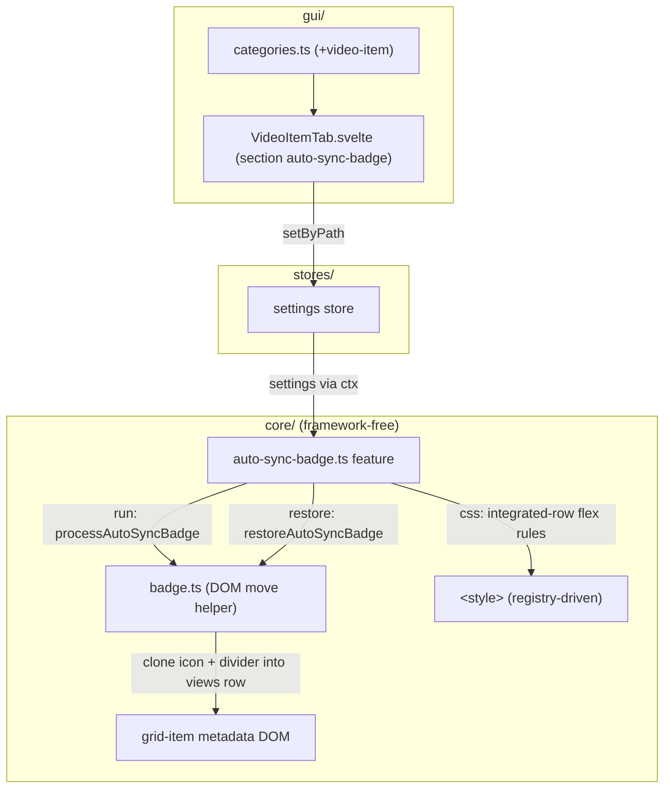
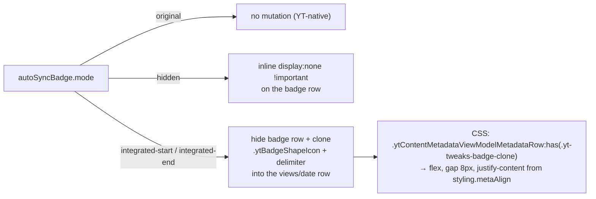
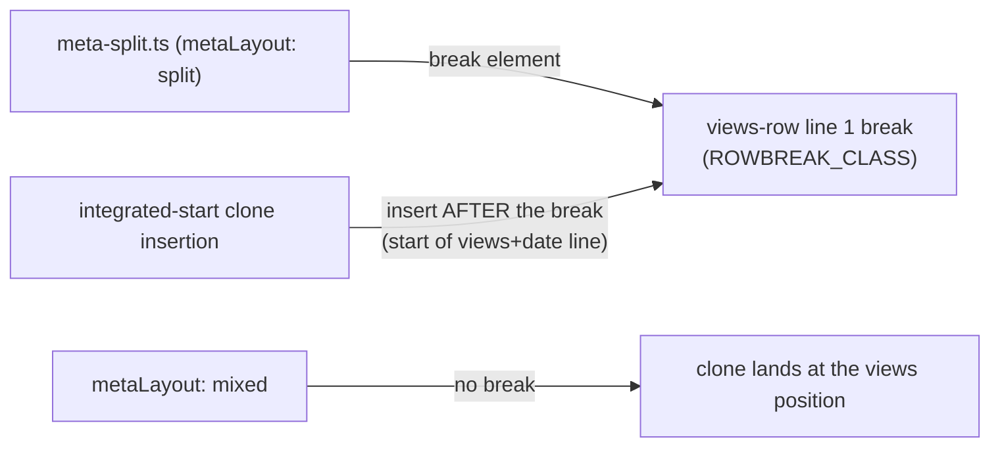
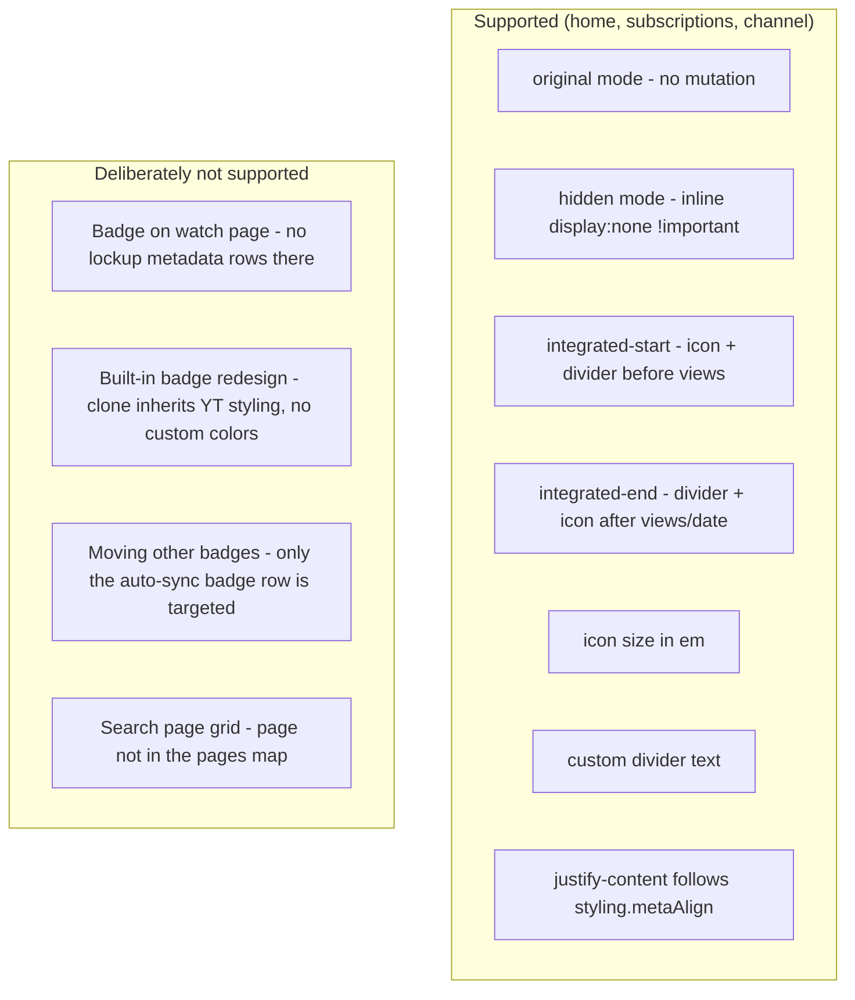

# Architecture: Auto-Sync-Badge Feature

> Grid-item "Auto-synced" badge ("Automatisch synchronisiert") handling: keep as-is, hide it,
> or integrate its icon into the views/date metadata row (DOM move + CSS). Active on home,
> subscriptions, and channel grid pages — the badge row exists inside grid-item lockups.
> Diagrams depict relationships, structure, and boundaries — no implementation details.

## Component Structure

## Badge Mode Resolution

**Why inline `!important` for `hidden`** (deliberate deviation from
[ADR 0001](../adr/0001-marker-attribute-over-inline-style.md)): the grid-styling feature
emits a `!important` block rule on the same metadata-row selector, and metaAlign variants
collide with equal specificity in the shared stylesheet. An inline `!important` at the
element level is the only layer that reliably wins; a marker attribute + stylesheet rule
would lose to the grid-styling rule. The marker attribute `data-yt-tweaks-badge-moved`
(value = mode) is still set for restore — ADR 0001's restore-guarantee is preserved.

**Why clones instead of custom spans**: the integrated modes clone YT's own
`.ytBadgeShapeIcon` and `.ytContentMetadataViewModelDelimiter` 1:1 — they inherit YT's
fill/color/spacing automatically. The inserted clones carry the class
`yt-tweaks-badge-clone` (restore removes them); a custom divider text setting replaces the
delimiter clone's text. The icon size (`iconSizeEm`) overrides the clone's inline 24px via
em.

**Meta-align coupling**: the views-row flex rule reads `styling.metaAlign` (from the
grid-styling feature) for `justify-content` — `center` → center, `right` → flex-end,
`block` → space-between, else flex-start. Both features target the same metadata row, so
the badge integration follows the grid-styling alignment choice.

## Interaction with meta-split

`integrated-start` must insert after meta-split's rowbreak element — inserting at the row
start would place the badge icon on the channel-name line. With `metaLayout: "mixed"`
(no break) the row start IS the views position. Covered by the cross-feature test
`meta-split × auto-sync-badge (integrated-start)` in meta-split.test.ts.

**Lazy-metadata failure path**: when the views row is not rendered yet, the DOM move is
aborted without setting the marker and without keeping the row hidden — the next observer
pass retries. Setting the marker on a half-applied state would freeze the row hidden with
no clone inserted.

## Scope Boundaries

## References

- Feature: `src/lib/core/features/auto-sync-badge.ts`
- Helper: `src/lib/core/badge.ts` (not a feature — DOM move logic)
- Settings: `src/lib/core/settings.ts` (`AutoSyncBadgeSettings`: mode `original|hidden|integrated-start|integrated-end`, iconSizeEm, divider)
- Coupled features: `src/lib/core/features/meta-split.ts` (rowbreak anchor), `src/lib/core/features/grid-styling.ts` (metaAlign)
- GUI: `src/lib/gui/tabs/VideoItemTab.svelte`
- Tests: `src/lib/core/__tests__/meta-split.test.ts` (cross-feature interplay), `src/lib/core/__tests__/video-item-migration.test.ts` (defaults deep-merge) — no dedicated badge test file; the DOM run is manually verified (badge-row fixture not yet captured)

Verified: 2026-10-24 — against `src/lib/core/features/auto-sync-badge.ts`, `src/lib/core/badge.ts`, `src/lib/core/settings.ts`, `src/lib/core/features/meta-split.ts` (ROWBREAK_CLASS import), `src/lib/gui/tabs/VideoItemTab.svelte` @ working tree (re-checked 2026-10-25 after the wording pass: VideoItemTab lost only Field `desc` props + i18n label strings — badge field paths + structure unchanged; re-checked 2026-10-25 after the ADR 0007 defaults change: DEFAULT_SETTINGS.autoSyncBadge now ships enabled true + mode "integrated-end" + iconSizeEm 1.1 — feature logic unchanged; settings.ts comment-only re-pass, no behavior change)
