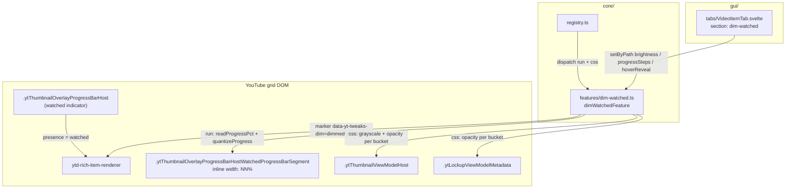
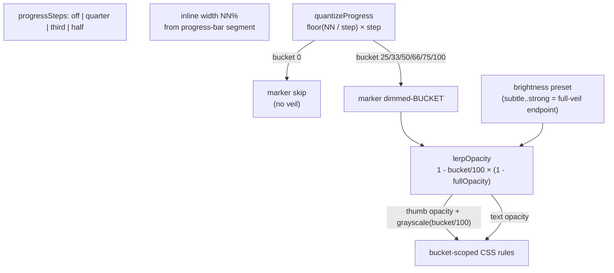
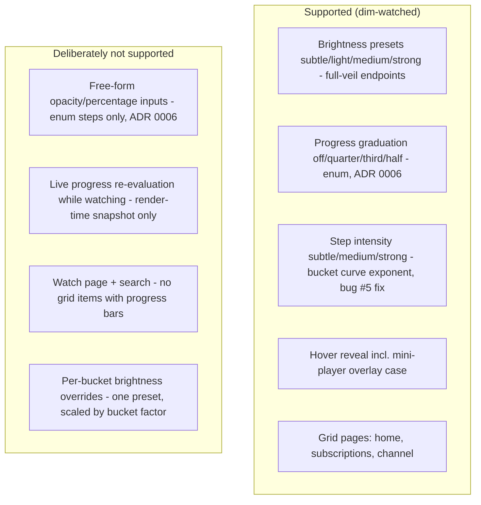

# dim-watched — Architecture

Desaturates + fades watched grid videos, graduated by watch progress (bucket-quantized
marker values, pure CSS per bucket). Diagrams depict relationships, structure, and
boundaries — no implementation details.

## Component Structure

## Progress Quantization (ADR 0006: enum steps, computed buckets)

- `progressSteps: off` = legacy behavior: every watched item gets the full veil
  (marker `dimmed-100`).
- Downward quantization (D1): a 49%-watched video at "half" gets no veil; 56% at "quarter"
  lands in the 50 bucket. Exact multiples are guarded by an epsilon (float step sizes,
  third = 33.333…) and the final value floored to stable integers (33/66/100).
- `stepIntensity` (bug #5 fix) bends the bucket factor curve: `factor = (bucket/100)^exp`
  with exp 1 (subtle) / 0.5 (medium) / 0.34 (strong). Linear scaling made the 25% bucket
  nearly invisible (25% of the veil); medium raises it to 50%, strong to ~62%. The 100%
  bucket always keeps the exact brightness-preset endpoint. Emitted values are rounded to
  3 decimals (no float noise in CSS).
- The DOM pass is idempotent per item via the marker attribute (ADR 0001): progress is
  read once per rendered item; Polymer re-renders replace the nodes, re-running the pass.
- `hoverReveal` emits the transition + reveal rules per bucket (`:hover` OR
  `:has(.ytSpecTouchFeedbackShapeHovered)` — the JS-driven hover class survives the
  mini-player overlay).

## Scope Boundaries

## References

- Feature: `src/lib/core/features/dim-watched.ts`
- Settings: `src/lib/core/settings.ts` (`DimWatchedSettings`, `DEFAULT_SETTINGS.dimWatched`)
- GUI: `src/lib/gui/tabs/VideoItemTab.svelte` (section `dim-watched`)
- Tests: `src/lib/core/__tests__/dim-watched.test.ts`,
  `src/lib/core/__tests__/dim-watched.fixture.test.ts` (subscriptions fixture with real
  progress percentages 10/24/56/81/100)
- Decision records: [ADR 0001 — marker attribute over inline style](../adr/0001-marker-attribute-over-inline-style.md),
  [ADR 0006 — preset enums over free-form CSS inputs](../adr/0006-preset-enums-over-freeform-css-inputs.md)
- DOM fixture: `src/lib/core/__fixtures__/subscriptions-grid-item.fixture.html` (captured 2026-08-23)

Verified: 2026-10-19 — against `src/lib/core/features/dim-watched.ts` (buckets, stepIntensity exponents 1/0.5/0.34, `data-yt-tweaks-dim` marker, liveApplyKeys), `src/lib/core/settings.ts` (`DimWatchedSettings`), `src/lib/gui/tabs/VideoItemTab.svelte` (section `dim-watched`) @ working tree (re-checked 2026-10-24 after the meta-split change: dim-watched feature + settings slice untouched; re-checked 2026-10-25 after the wording pass: VideoItemTab lost only Field `desc` props — brightness/progressSteps/stepIntensity/hoverReveal paths unchanged; re-checked 2026-10-25 after the ADR 0007 defaults change: DEFAULT_SETTINGS.dimWatched now ships enabled true, hoverReveal true, progressSteps "third" — bucket math + CSS emission unchanged; settings.ts comment-only re-pass, no behavior change)
