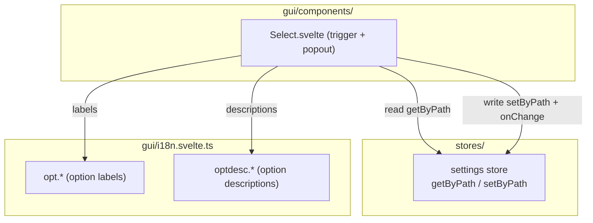
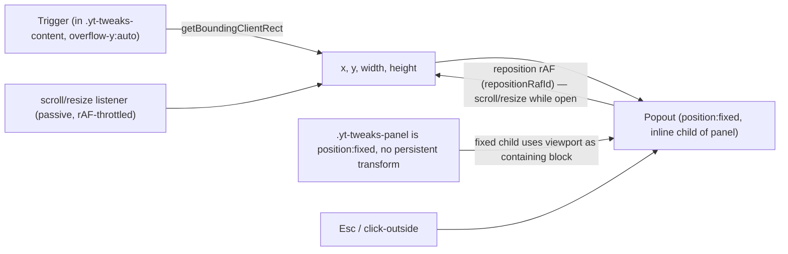
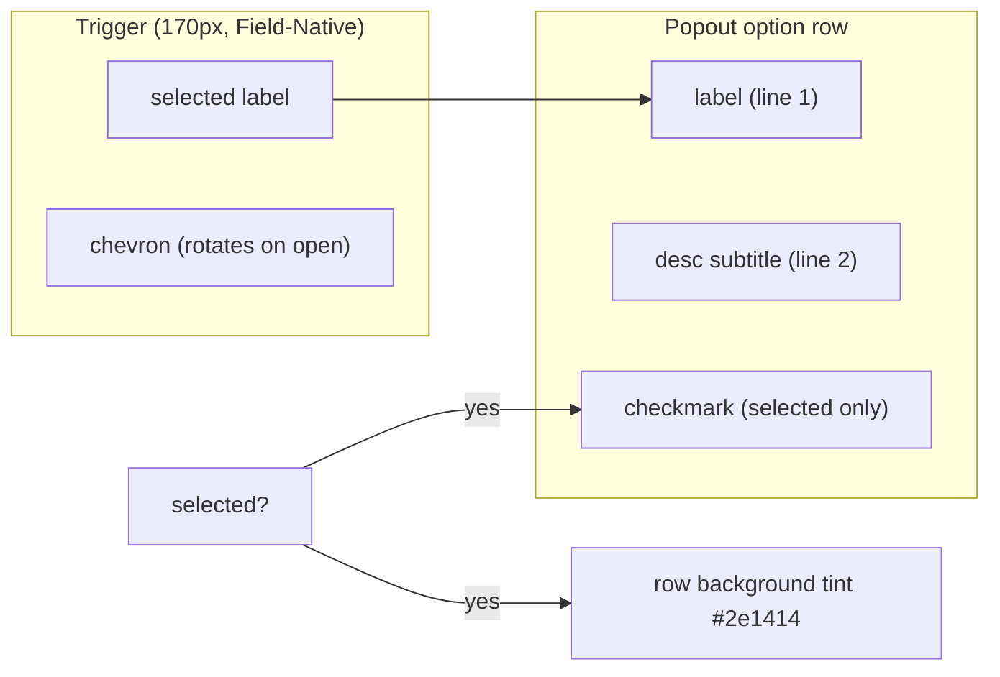

# Architecture: Custom Dropdown (Select-Ersatz)

> Replaces the native `<select>` control with a fully custom, themeable dropdown (DD7 Two-Line
> Rich). Renders a Field-Native trigger and a Floating Popout positioned `fixed` to escape
> the scroll-clipping panel container. Each option shows a label plus a descriptive
> subtitle (`desc`). Drop-in compatible with the existing prop interface (`path`, `options`,
> `num`, `onChange`, `SelectOption`). Diagrams depict relationships, structure, and
> boundaries — no implementation details.

## Component Structure



## Popout Clipping Solution (position:fixed)



The reposition and scroll-into-view paths use TWO SEPARATE rAF ids
(`repositionRafId` / `scrollRafId`) — they are unrelated mechanisms and must never
cancel each other's pending frame.

> Plan D1 specified "Svelte-Portal zu `document.body`". Deviated: since `.yt-tweaks-panel` is
> itself `position:fixed` with no persistent `transform` (the intro animation uses
> `transform: scale()` for 0.16s only, no `fill-mode:forwards`), a `position:fixed` child uses the
> viewport as its containing block — escaping `.yt-tweaks-content`'s `overflow-y:auto` cleanly.
> Inline `position:fixed` avoids R4 (YT-CSS-context risk on a `document.body` portal). Svelte 5.56
> has no stable `svelte:portal` element anyway. Full rationale: [ADR 0004](../adr/0004-fixed-position-popout-over-body-portal.md).

## Store Binding (read + write)

```mermaid
flowchart TB
  Path["path (dot-notation)"]
  CurrentValue["currentValue = String(store.getByPath(path))"]
  Options["options: SelectOption[] (value + label + desc?)<br/>$derived in tabs — live locale switch"]
  CurrentValue -->|match| Selected["selected option"]
  Options --> Selected
  Selected -->|trigger label| TriggerLabel["trigger shows label"]
  Click["user clicks option"]
  Click -->|num? Number(val) : val| Resolved["resolved value"]
  Resolved -->|store.setByPath(path)| Store["settings store"]
  Resolved -->|onChange?.(val)| Callback["optional side-effect"]
```

**`num` caveat**: `num` coerces the option value via `Number(value)` — use it ONLY for
numeric-valued enums (e.g. `"0.8"` em sizes). String enums (e.g. `styling.titleMaxLines`
with values like `"2"`, `"3"`, `"99"`) must NOT pass `num`; the value is stored as the
string as-is.

## Option Row Layout (DD7 Two-Line Rich)



## Scope Boundaries

```mermaid
flowchart TB
  subgraph Supported["Supported (DD7)"]
    A1[Field-Native trigger — full field width, dark box, chevron]
    A2[Floating popout — position:fixed inline child of the panel, no portal]
    A3[Two-line option rows — label + desc subtitle]
    A4[Checkmark + tint selected indicator]
    A5[Reposition-on-scroll/resize — TWO separate rAF ids (reposition + scroll-into-view)]
    A6[A11y — role listbox/option, aria-expanded, arrow nav, Esc, click-outside]
    A7[Clipping-safe — popout escapes .yt-tweaks-content overflow]
    A8[Trusted-Types-safe — Svelte templates, no innerHTML]
  end

  subgraph OutOfScope["Out of scope (not implemented)"]
    B1[Segmented variant (DD5) — NOT a Select variant: exists as its own component, Segmented.svelte]
    B2[Color swatch variant (DD4) — color-only, not generic]
    B3[Icon variant (DD8) — needs icon map per options-set]
    B4[Native select fallback — fully replaced, no progressive enhancement]
    B5[Graceful single-line fallback — desc is provided for all sets]
  end
```

## References

- Component: `src/lib/gui/components/Select.svelte`
- Types: `src/lib/gui/types.ts` (`SelectOption`)
- Store: `src/lib/stores/settings.svelte.ts` (`getByPath`/`setByPath`)
- i18n: `src/lib/gui/i18n.svelte.ts` (`opt.*`, `optdesc.*` keys)
- Decision: [ADR 0004](../adr/0004-fixed-position-popout-over-body-portal.md)

Verified: 2026-10-19 — against `src/lib/gui/components/Select.svelte` (separate repositionRafId/scrollRafId, num coercion), `src/lib/gui/components/Segmented.svelte`, `src/lib/gui/tabs/FeedChipsTab.svelte` ($derived options), `src/lib/gui/tabs/VideoItemTab.svelte` (titleMaxLines string enum without num) @ working tree (re-checked 2026-10-24 after the meta-split change: VideoItemTab gained metaLayout/metaStatsGap Selects — both plain string-enum selects without `num`, the titleMaxLines-without-num invariant still holds; re-checked 2026-10-25 after the wording pass: three optdesc keys removed from i18n — none were consumed by any Select, the opt._/optdesc._ key model is unchanged; re-checked 2026-10-25 after the ADR 0007 defaults change: one new option `optdesc.logSilent` added for the SystemTab log-level Select (options are still built from LOG_LEVEL_LABELS) — dropdown mechanics unchanged)
