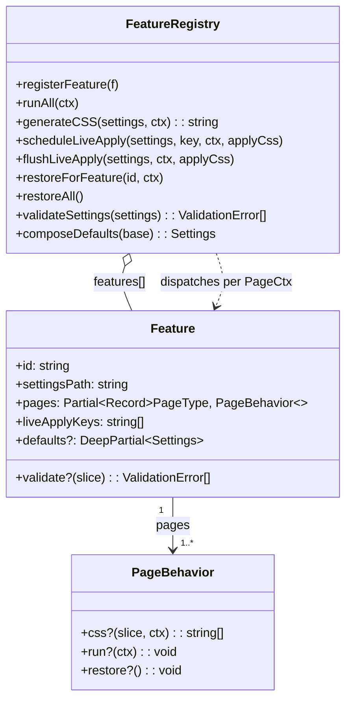
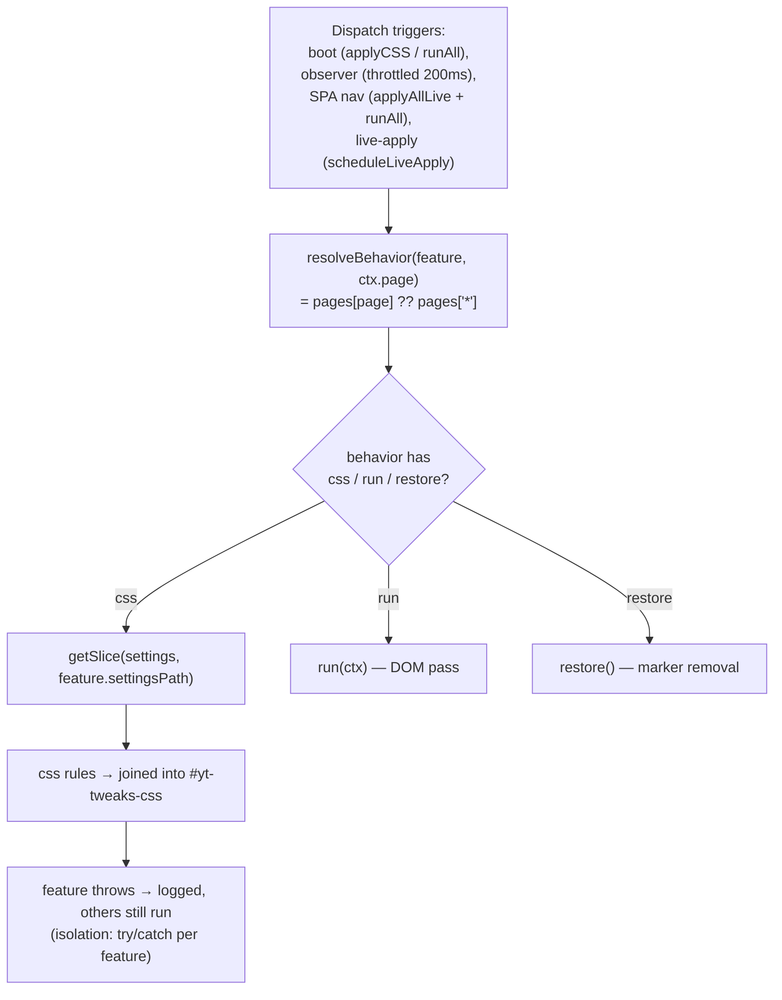
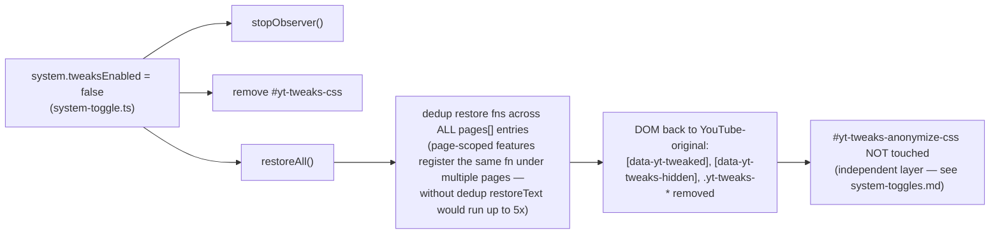
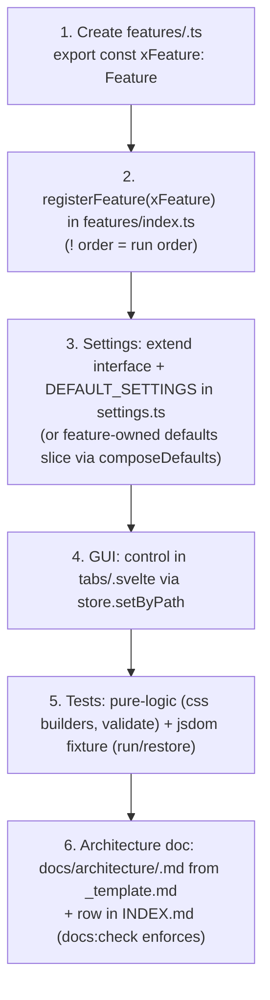

# Architecture: Feature Registry

> The extension-point architecture: every tweak is a self-registering `Feature` with per-page
> behaviors (`css`/`run`/`restore`); the `FeatureRegistry` dispatches them per `PageCtx`.
> Replaced three hardcoded dispatch sites (runOnce body, live-apply key switch, monolithic
> `generateCSS`). Diagrams depict relationships, structure, and boundaries.

## Feature Contract



**Behavior types:**

- `css` — pure function `(settingsSlice, ctx) → string[]`; the registry concatenates all
  rules into a single stylesheet (`#yt-tweaks-css`). No DOM access, fully unit-testable.
- `run` — DOM mutation pass (e.g. text-shorten, ads-hide, button hiding). Marker-based and
  idempotent: re-runs must be no-ops on already-processed nodes.
- `restore` — undoes prior mutations. Required for every `run`; marker removal is global, so
  no `PageCtx` is passed.

## Dispatch: Page → Behavior



**`"*"` fallback**: a feature that declares `pages["*"]` runs on every page. Page-specific
features declare only their pages — dispatch on other pages is a no-op (e.g. `ytd-watch-metadata`
exists solely on `/watch`, so `watch-page` never declares `"*"`).

**Error isolation**: every dispatch (`run`, `css`, `restore`) is wrapped in try/catch per
feature — one broken feature logs an error but never breaks the pass for the others.

## Live-Apply Pipeline (settings change → DOM update)

```mermaid
sequenceDiagram
  participant GUI as GUI (setByPath)
  participant Store as settings store
  participant Obs as observer.ts
  participant Reg as registry.ts
  participant DOM as DOM

  GUI->>Store: setByPath(path, value)
  Store->>Obs: scheduleLiveApply(settings, changedKey)
  Obs->>Reg: scheduleLiveApply(settings, key, ctx, injectCSS) [debounced 150ms]
  Note over Reg: batches rapid input (typing) — keys accumulate
  Reg->>Reg: restore features whose liveApplyKeys PREFIX-MATCH a changed key<br/>(equal OR child path: "guide.entries.hidden.&lt;id&gt;" matches "guide.entries.hidden")
  Reg->>DOM: restore() (marker removal)
  Reg->>Reg: generateCSS(settings, ctx)
  Reg->>DOM: injectCSS(css) — #yt-tweaks-css textContent update
  Reg->>Reg: runAll(ctx) — ALL features re-run unconditionally
```

**Why key-driven restore**: an untargeted restore-all would flash unchanged features (e.g.
re-shortening all text on a font-size change). `liveApplyKeys` declares which settings
paths actually require the feature's restore+rerun; everything else keeps its DOM state.

**Why PREFIX matching**: changed keys can be dynamic child paths of a registered key —
per-entry guide toggles change `"guide.entries.hidden.<entryId>"`, which must match the
registered `"guide.entries.hidden"`. Exact equality alone would silently drop every
dynamic sub-path mutation. The timer body then re-runs ALL features unconditionally
(not only matched ones) — that unconditional re-run is what makes per-entry toggles
apply live.

**Why debounce (150ms) + flush**: rapid slider/stepper input batches into one pass;
`flushLiveApply` EXECUTES a pending restore pass immediately on save/import (dropping it
would leave a feature toggled off within the debounce window mutated until reload —
the pending keys decide which features get restored; the CALLER's settings/ctx decide
what is re-applied). With no pending pass, flush only refreshes the CSS. Wholesale
settings replacement (reset/importJson) additionally goes through the observer's
`restoreAndRunAll(settings)` — restore every feature's mutations, then re-apply CSS +
re-run all features from the new settings.

## Restore-All (kill-switch) and Dedup



## Adding a Feature (workflow)



**Registration order = run order**: `runAll` dispatches in registration order. An order
dependency is legitimate when one feature's pass consumes another's DOM output within the
SAME registry pass — `meta-split` registers AFTER `text-shorten` because its marker-fallback
anchor (`[data-yt-tweaks-views]`) is set by the text pass, and boot runs `runAll()` only
once before the observer starts (a first-pass marker dependency on a later pass would
never resolve on static DOM). Features still never import each other (N2) — the dependency
is run-order only and is asserted by a unit test over the registration order.

**Helper modules are not features**: `chip-layout.ts`, `guide-groups.ts`, and `meta-icons.ts`
export shared functions consumed by features — they never register with the registry and get
no doc of their own (documented inside their consumer's doc).

## Scope Boundaries

```mermaid
flowchart TB
  subgraph Supported["Supported (registry)"]
    S1[17 registered features — see INDEX.md coverage table]
    S2[Per-page dispatch with "*" fallback]
    S3[Prefix-matched key-driven live-apply restore + debounced rerun]
    S4[Composed defaults (feature slices merged over base)]
    S5[Aggregated validation errors per feature]
  end
  subgraph NotSupported["Deliberately not supported"]
    N1[Runtime feature registration/unregistration by users]
    N2[Feature interdependencies — features never import each other<br/>(shared logic goes into helper modules)]
    N3[Cross-feature orchestration — the registry stays a dumb dispatcher]
  end
```

## References

- Registry: `src/lib/core/registry.ts`
- Feature contract: `src/lib/core/feature.types.ts`
- Registration: `src/lib/core/features/index.ts`
- Observer dispatch: `src/lib/core/observer.ts`
- Page detection: `src/lib/core/page.ts`
- Settings: `src/lib/core/settings.ts`
- Related docs: [system-overview.md](system-overview.md), [system-toggles.md](system-toggles.md)
- Hot-path debug guards: [ADR 0005](../adr/0005-isdebugenabled-guard-over-unguarded-log-args.md)

Verified: 2026-10-24 — against `src/lib/core/registry.ts`, `src/lib/core/feature.types.ts`, `src/lib/core/features/index.ts` (17 registered features; meta-split after text-shorten — run-order dependency), `src/lib/core/observer.ts` (scheduleLiveApply/flushLiveApply/restoreAndRunAll wiring; boot runs runAll() before startObserver()) @ working tree (re-checked 2026-10-25 after the ADR 0007 defaults change: DEFAULT_SETTINGS shipped a curated baseline — registry dispatch/live-apply wiring unchanged; settings.ts comment-only re-pass, no behavior change; removed the Plan-history reference — docs/plans/ stays internal and is not published with the repo)
