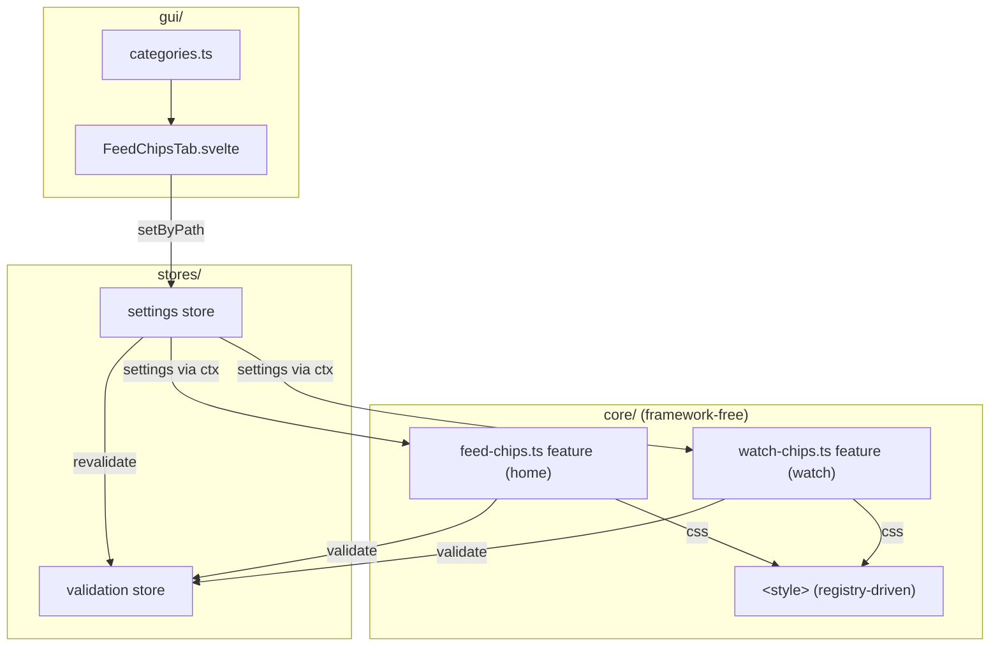
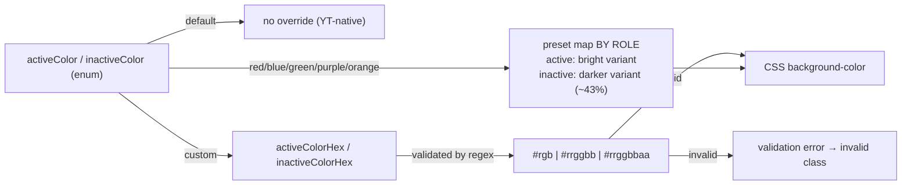
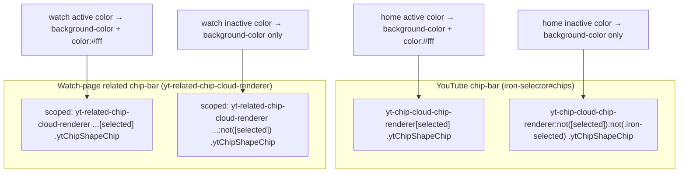
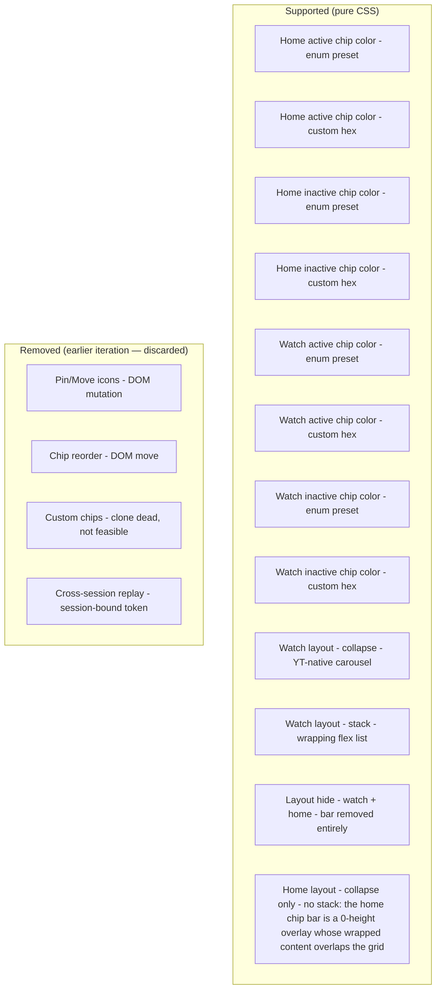

# Architecture: Filter-Chips Features

> Homepage + watch-page filter-chip color override (active + inactive). Pure CSS — no DOM
> mutation. Overrides the background color of YouTube's filter chips. The category
> ("Filter-Chips") contains two independent features with separate settings: the homepage
> filter-chip bar (`feed-chips`, page: home) and the watch-page related-video sidebar chip bar
> (`watch-chips`, page: watch). Diagrams depict relationships, structure, and boundaries — no
> implementation details.

## Component Structure

## Color Resolution (Enum + Custom Hex)

- The two roles resolve the SAME preset name to different shades: the active chip gets the
  bright variant (e.g. red `#b30024`), the inactive chip the darker sibling (e.g. red
  `#4e0010`) — a deliberate active/inactive brightness gradient instead of two equal colors.
- Each feature keeps its own copies of the two preset maps (feed-chips and watch-chips mirror
  each other 1:1).

## CSS Application (Selector Targets)

## Scope Boundaries

## References

- Features: `src/lib/core/features/feed-chips.ts`, `src/lib/core/features/watch-chips.ts`
- Shared helper: `src/lib/core/features/chip-layout.ts` (not a feature — consumed by watch-chips)
- Settings: `src/lib/core/settings.ts`
- GUI: `src/lib/gui/tabs/FeedChipsTab.svelte`
- Tests: `src/lib/core/__tests__/feed-chips.test.ts`, `src/lib/core/__tests__/watch-chips.test.ts`, `src/lib/core/__tests__/chip-layout.test.ts`

Verified: 2026-10-25 — against `src/lib/core/features/feed-chips.ts`, `src/lib/core/features/watch-chips.ts` (re-checked 2026-10-25: per-role preset maps ACTIVE_PRESETS/INACTIVE_PRESETS replace the shared COLOR_PRESETS — active red #b30024, inactive red #4e0010, other hues derived by the same ~70%/43% brightness factors), `src/lib/core/features/chip-layout.ts`, `src/lib/core/settings.ts` (`ChipLayout = collapse|stack|hide`, home excludes `stack`), `src/lib/gui/tabs/FeedChipsTab.svelte` ($derived option arrays) @ working tree (re-checked 2026-10-25 after the ADR 0007 defaults change: DEFAULT_SETTINGS now ships both chip features enabled with the red presets (active `#b30024` / inactive `#4e0010`) and layouts home "collapse" / watch "stack"; a new one-time migration normalizes a saved `feedChips.layout: "stack"` to `"collapse"` — CSS model + selectors unchanged; settings.ts comment-only re-pass, no behavior change)
