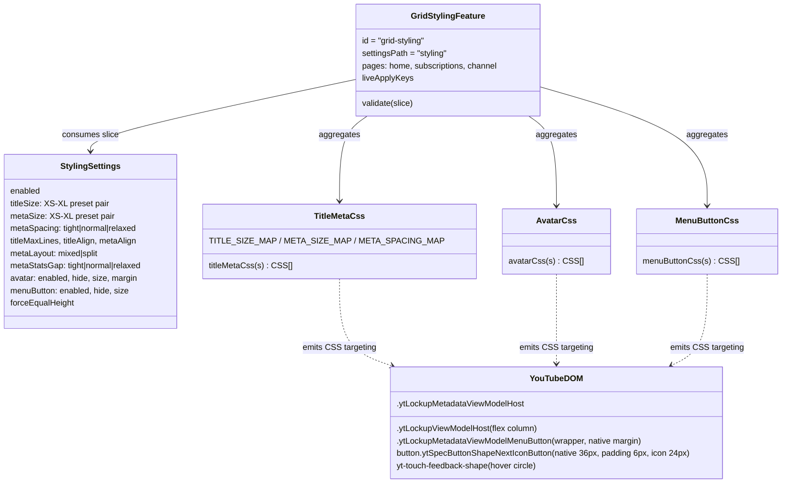
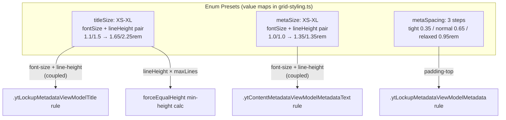
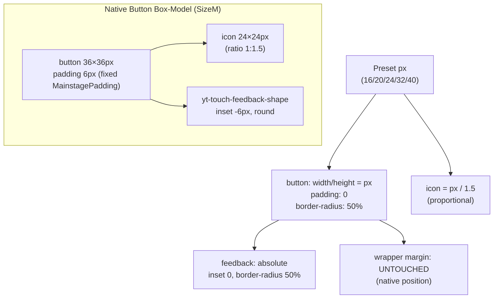
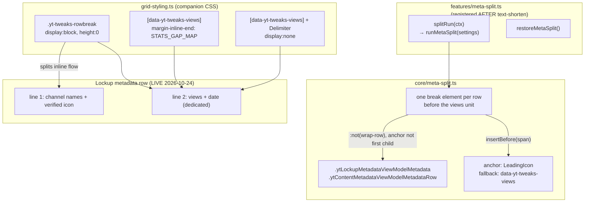

# grid-styling — Architecture

Video-item metadata styling (title/meta typography presets, avatar, menu-button) for grid
pages (home, subscriptions, channel). Diagrams depict relationships, structure, and
boundaries — no implementation details.

## Component Structure



## Typography Presets (V2 Rework, ADR 0006)



### Decision: why typography became preset pairs (ADR 0006)

- **V0 (old):** five free-form rem inputs (`titleFontSize`, `titleLineHeight`,
  `metaFontSize`, `metaLineHeight`, `metaPaddingTop`) plus two margin fields
  (`titleMarginLeft/Right`). Unrestricted pair combinations could break
  `-webkit-line-clamp` (line-height × maxLines reservation) and the `forceEqualHeight`
  `min-height` calc; asymmetric margins made centered titles look off. This was the
  root cause of the recurring "alignment/text size looks broken" class.
- **V2 (new):** `titleSize`/`metaSize` are enum presets mapping to fixed
  `{fontSize, lineHeight}` pairs (`lineHeight ≥ fontSize` at every step — asserted by
  tests). `metaSpacing` replaces the rem padding input with 3 steps. Margins are gone
  entirely (no rules emitted). The CSS builder, the `forceEqualHeight` calc, and the
  validator all read the same exported maps — single source of truth.
- **Full clamp chain (bug #1 fix):** `-webkit-line-clamp` alone half-cut the 3rd line —
  YouTube's NATIVE `max-height` (dimensioned for the native line-height) clipped our
  taller preset lines. The title rule owns the entire chain now: `line-height` (preset) ×
  `max-lines` as `max-height: calc(LH × N)`, plus `overflow: hidden`,
  `display: -webkit-box`, `-webkit-box-orient: vertical`. The "99" (all lines) option
  releases the clamp entirely (`-webkit-line-clamp: unset; max-height: none`).
  `titleMaxLines` is a STRING enum — the GUI Select must NOT pass the `num` coercion
  prop (a coerced `Number("99")` breaks the strict-equality check in the CSS builder).
- **Migration:** `loadSettings` maps stored rem strings to the nearest preset by
  font-size (rem-format only, other units → medium/normal fallback) and deletes the
  legacy keys once. Default rem values map losslessly onto medium/medium/normal.

## Menu-Button Sizing (V1 Rework)



### Decision: why only the `<button>` is scaled

- **V0 (old):** forced width/height on icon, icon wrapper, button, button view-model, and
  feedback layer. The native padding (6px, fixed MainstagePadding — does not scale) remained →
  the icon overflowed the hover circle; the fixed native radius no longer matched the size →
  oval/stadium shapes. Additionally, `.ytLockupMetadataViewModelMenuButton { margin: 0px !important }`
  overrode the native wrapper margin (YT positions the button flush with the metadata edge
  via that margin) → the button jumped into the corner.
- **V1 (new):** only the `<button>` receives the click size, with `padding: 0` and
  `border-radius: 50%` → the hover circle stays round and congruent with the click surface at
  every size. The icon scales proportionally (native ratio 1:1.5, `calc(px / 1.5)`). The
  feedback layer is positioned absolutely over the button (`inset: 0`, `border-radius: 50%`).
  The wrapper margin is never overridden → no position jumps.

### Removed: `styling.menuButton.margin`

The GUI field "Button-Margin" was removed (interface, defaults, GUI, liveApplyKeys). The
migration in `loadSettings()` deletes the orphaned key from storage once (`delete`, no
mapping).

### Removed: `styling.titleMargin*` + rem typography fields (V2)

Same removal rationale as menuButton.margin, generalized by
[ADR 0006](../adr/0006-preset-enums-over-freeform-css-inputs.md): free-form CSS values that
participate in layout invariants become preset enums or are dropped as settings.

## Meta Line Split (metaLayout, 2026-10-24)



### Decision: break element over node moves

- YouTube's CURRENT lockup renders names + views + date in ONE inline metadata row: long
  names wrap views+date raggedly (Fall 1), multi-channel rows use EMPTY delimiters that
  glue items (Fall 2). The captured 2026-08-23 home grid still had SEPARATE rows per part —
  YouTube merged them since; the old fixture can no longer exercise the pass.
- The split inserts ONE `<span class="yt-tweaks-rowbreak">` before the views unit (anchor:
  structural leading icon, fallback `[data-yt-tweaks-views]` — bug #11 marker rationale:
  structural selectors lie, the text pass is the only reliable classifier). NO nodes are
  moved: restore removes all breaks, re-runs re-insert (ADR 0001 pattern).
- **Registration order matters**: `meta-split` runs AFTER `text-shorten` so the marker
  fallback is set within the SAME registry pass (boot runs `runAll()` once, THEN starts
  the observer — a first-pass marker dependency on a later pass never resolves).
  Asserted by a unit test over the registration order.
- Rows whose anchor is the FIRST child (nothing on line 1) and badge wrap rows are skipped.
- `metaAlign:"block"` (flex space-between) has no per-line meaning in a split row →
  documented fallback to `text-align: left`; left/center/right apply per line (both
  lines follow metaAlign — user decision 2026-10-24).
- `metaStatsGap` (STATS_GAP_MAP: tight 8 / normal 16 / relaxed 24px) replaces the
  delimiter roulette — the delimiter between views and date is displaced, the margin
  carries the constant gap.
- **Delimiter normalization (measured live 2026-10-24)**: YouTube gives EVERY
  `.ytContentMetadataViewModelDelimiter` margin 4px/4px — an EMPTY multi-channel
  delimiter (0px wide) therefore rendered a ~8px double-space between the channel
  names. Split mode neutralizes delimiter margins and injects a real space char into
  EMPTY delimiters (`:empty::before { content: " " }`) so the multi-channel join
  matches single-channel rows exactly (verified computed in the E2E join test).
  Trailing spaces before the break hang at line end (no center-alignment shift).
- `shortenViews` off → no views marker → the structural leading-icon anchor still splits;
  only the constant gap degrades to YT's native delimiter spacing (graceful).
- **auto-sync-badge interplay** (badge.ts): `integrated-start` clones land AFTER the
  break (start of line 2); `integrated-end` (row end = line 2 end) is unaffected; in
  mixed layout both keep their original insertion points.

## Scope Boundaries

```mermaid
flowchart TB
  subgraph Supported["Supported (grid-styling + meta-split)"]
    S1[Title/meta size preset pairs + spacing + align + maxLines - CSS]
    S2[Avatar hide + size + margin - CSS]
    S3[Menu button hide + size (presets 16-40px) - CSS]
    S4[Force equal height - CSS]
    S5[Meta line split mixed/split + stats gap presets - DOM pass + CSS]
  end
  subgraph NotSupported["Deliberately not supported"]
    N1[Free-form rem inputs - removed in V2, ADR 0006]
    N2[Title margins - removed in V2 (asymmetry broke center-align)]
    N3[Menu button margin override - removed in V1 (position jumps)]
    N4[Split on watch/search pages - grid pages only (grid-styling scope)]
  end
```

## References

- Feature: `src/lib/core/features/grid-styling.ts`,
  `src/lib/core/features/meta-split.ts` (DOM-pass feature, shared `styling` slice)
- Pass + restore: `src/lib/core/meta-split.ts` (`runMetaSplit`, `restoreMetaSplit`)
- Settings: `src/lib/core/settings.ts` (`StylingSettings`, `DEFAULT_SETTINGS.styling`, migration)
- GUI: `src/lib/gui/tabs/VideoItemTab.svelte` (section `styling`)
- Tests: `src/lib/core/__tests__/grid-styling.test.ts`,
  `src/lib/core/__tests__/meta-split.test.ts` (pass, restore, badge interplay,
  registration order),
  `src/lib/core/__tests__/video-item-migration.test.ts`,
  `src/lib/core/__tests__/masthead-migration.test.ts`
- E2E: `e2e/tests/meta-split.spec.ts`
- Decision records: [ADR 0006 — preset enums over free-form CSS inputs](../adr/0006-preset-enums-over-freeform-css-inputs.md)
- DOM fixtures: `src/lib/core/__fixtures__/home-grid-item.fixture.html` (captured 2026-08-23,
  OLD separate-rows structure — guards against false breaks),
  `src/lib/core/__fixtures__/lockup-meta-split.fixture.html` (SYNTHETIC, built from the
  user-reported LIVE DOM 2026-10-24 — current one-row structure, Fall 1/2/3)

Verified: 2026-10-24 — against `src/lib/core/features/grid-styling.ts` (metaLayout split companion CSS: rowbreak box, STATS_GAP_MAP 8/16/24px, metaAlign block→left fallback, delimiter margin neutralization + `:empty` space injection), `src/lib/core/features/meta-split.ts` + `src/lib/core/meta-split.ts` (anchor leading-icon → views-marker fallback, anchorIsFirst skip, wrap-row skip, restore), `src/lib/core/badge.ts` (integrated-start after the rowbreak), `src/lib/core/settings.ts` (`metaLayout`/`metaStatsGap` enums; curated defaults split/normal per ADR 0007), `src/lib/gui/tabs/VideoItemTab.svelte` (metaLayout + metaStatsGap fields) @ working tree (re-checked 2026-10-25: stale POC file reference removed from this doc — the POC was never persisted; re-checked 2026-10-25 after the ADR 0007 defaults change: DEFAULT_SETTINGS now ships metaLayout "split", titleAlign/metaAlign "center", titleMaxLines "3", forceEqualHeight true, avatar.hide true, menuButton.size "large" — CSS maps + selectors unchanged; settings.ts comment-only re-pass, no behavior change)
