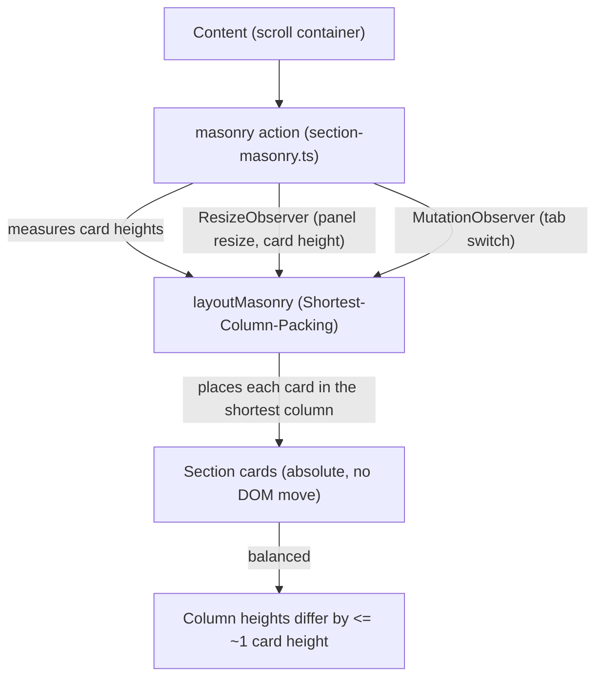
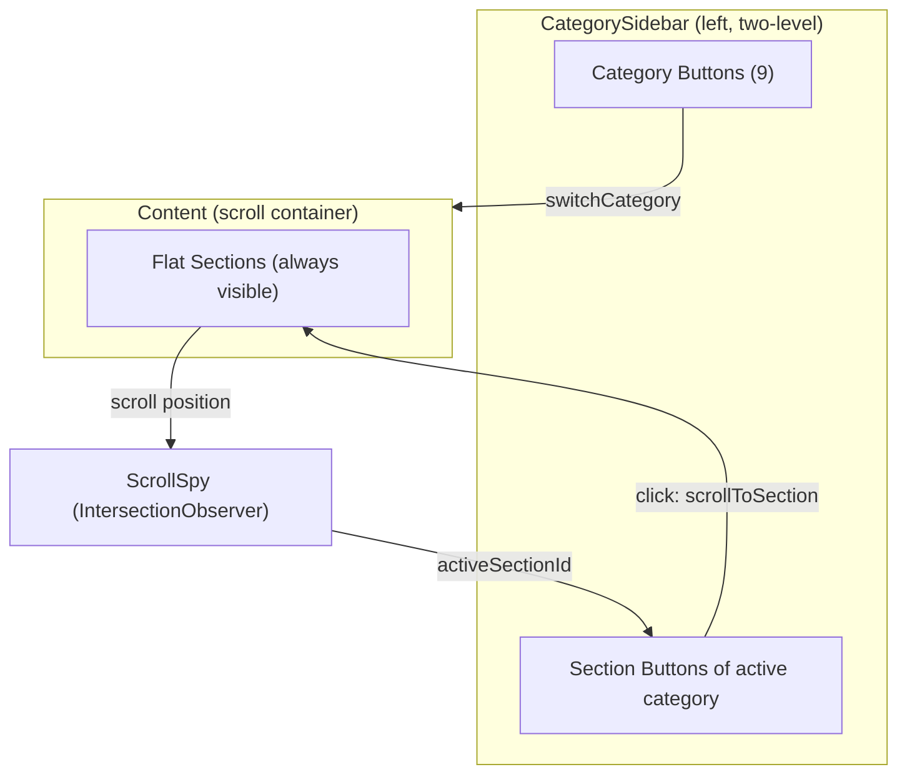
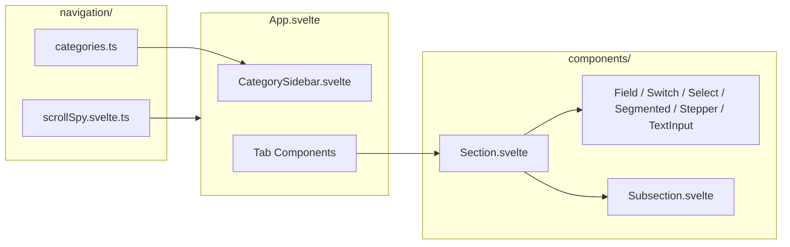
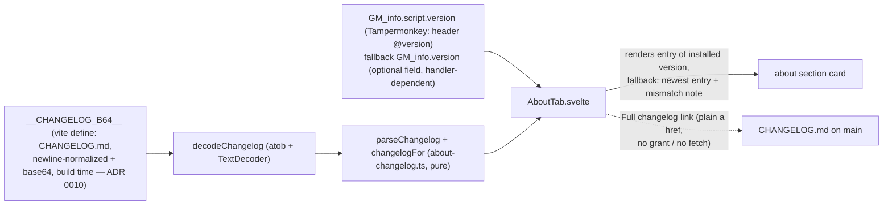
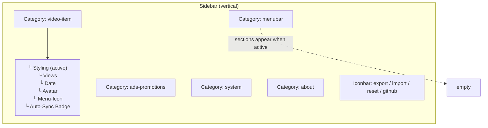

# Architecture: GUI Navigation

> Navigation model for the YouTube UI Tweaks settings panel — two-level category
> sidebar with scroll-spy + flat sections. Replaces the old tab/accordion/group
> hierarchy. Diagrams depict relationships, structure, and boundaries — no
> implementation details.

## Section Layout (Balanced Masonry)



- Column count derives from the content width alone (MIN_COLUMN = 420px) — the
  panel is user-resizable, so viewport media queries do not apply.
- Cards are absolutely positioned (width/left/top inline); DOM order is
  preserved — scroll-spy, drag-and-drop, and Svelte reactivity stay intact.
- Replaces CSS multi-column: the sequential column balancer overflowed the
  right column by >1 card when card-height variance is high; the JS packer
  targets the shortest column instead, keeping columns balanced.
- Single-section categories (about, startpage, watch-page) span the full
  width (single-card full-width case in layoutMasonry).
- The action dedupes its rAF callbacks (one pending layout rAF) — repeated
  resize events within a frame trigger one measurement pass.
- Unit-tested pure function (`layoutMasonry`) — node env, no DOM.

## Navigation Hierarchy (2 levels, was 4)



## Component Structure



## 9 Categories → Sections

```mermaid
  flowchart TB
  subgraph "video-item"
    S1[Styling]
    S2[Views]
    S3[Date]
    S4[Avatar]
    S5[Menu-Icon]
    S6[Auto-Sync Badge]
    S7[Hide YT Elements]
    S8[Watched Videos]
    S9[Preview Delay]
  end

  subgraph "menubar"
    M1[Masthead left]
    M2[Search Bar]
    M3[Masthead right]
    M4[Custom Buttons]
    M5[Styling]
  end

  subgraph "guide-sidebar"
    G1[Behavior]
    G2[Expanded]
    G3[Collapsed]
    G4[Group Order + Groups (main, subscriptions, myYouTube, moreFromYT, discover, system)]
    G5[Show More]
  end

  subgraph "feed-chips"
    C1[Start-Chips - active + inactive chip color (home)]
    C2[Watch-Page Chips - active + inactive chip color (watch sidebar)]
  end

  subgraph "startpage"
    SP1[Grid Columns]
  end

  subgraph "watch-page"
    W1[Watch Layout]
  end

  subgraph "ads-promotions"
    A1[Promo Hide]
    A2[Shelves]
    A3[Survey]
  end

  subgraph "system"
    T1[Tweaks]
    P1[Panel]
    P2[Logging]
    P3[Status]
  end

  subgraph "about"
    AB1[About]
  end
```

## About Tab (Data Flow)



- The embedded changelog is the raw release-please markdown of the same build — the release
  PR merges header version, CHANGELOG.md and the attached asset in one commit
  ([ADR 0008](../adr/0008-release-please-automation-contract.md)), so version + changelog
  cannot diverge. Rendering decisions: [ADR 0010](../adr/0010-about-tab-changelog-embedded-at-build-time.md).
- ! The version source is `GM_info.script.version` (REQUIRED per the Tampermonkey GM_info
  type): the top-level `GM_info.version` is optional and observed (TM 5.5.0) to return the
  script-handler extension version instead of the header version.

## Panel A11y (Keyboard Support)

- **Modal focus trap**: Tab/Shift+Tab cycle within the panel (without it, Tab escapes
  into YouTube's DOM); Escape closes; panel drag stays a deliberate mouse gesture.
- **Keyboard resize**: the 8 resize handles are focusable buttons with
  `a11y.resize*` aria-labels (i18n); arrow keys resize by a step.
- **Keyboard drag-and-drop**: the DraggableRow grip is a focusable button —
  ArrowUp/ArrowDown reorder rows.
- **Accessible names**: Switch/TextInput/Stepper carry accessible names;
  the Segmented container is no longer a second tab stop.

## Data Flow: Scroll-Spy

```mermaid
sequenceDiagram
  participant User
  participant Content as Content (scroll)
  participant Spy as ScrollSpy
  participant Sidebar as Section Buttons

  User->>Content: scrolls
  Content->>Spy: IntersectionObserver callback
  Spy->>Spy: pick topmost intersecting section (rAF debounced)
  Spy->>Sidebar: activeSectionId updates (reactive)
  Note over Sidebar: .active stays a state hook — no visual highlight<br/>(deliberately removed; only the category button is highlighted)

  User->>Sidebar: clicks a section button
  Sidebar->>Content: scrollIntoView(smooth, block:start)
  Content->>Spy: new intersection triggers
```

## Two-Level Sidebar Layout



## What Was Removed (Old Model)

| Old Component           | Replaced By                          | Reason                                                             |
| ----------------------- | ------------------------------------ | ------------------------------------------------------------------ |
| Accordion.svelte        | Section.svelte (no collapse)         | Single-open policy was manual overhead                             |
| AccordionGroup.svelte   | — (removed)                          | Context-based single-open scope not needed                         |
| accordionGroupRegistry  | ScrollSpy (IntersectionObserver)     | Global string-ID registry was fragile                              |
| Group.svelte            | Section.svelte (with toggleKey)      | Collapse + toggle merged into flat section header                  |
| TABS (App.svelte)       | CATEGORIES (categories.ts)           | Region-based categories, future-proof                              |
| scrollToSubsection      | scrollToSection (direct, no timeout) | No 240ms transition wait — sections always visible                 |
| switchTab setTimeout(0) | switchCategory (sync)                | No mount-race — no auto-open needed                                |
| PillNav.svelte          | Section buttons in CategorySidebar   | Horizontal pills don't scale (overflow); sidebar scales vertically |

## References

- Navigation: `src/lib/gui/navigation/categories.ts`, `src/lib/gui/navigation/scrollSpy.svelte.ts`
- Masonry: `src/lib/gui/navigation/section-masonry.ts` (pure: `layoutMasonry`)
- Components: `src/lib/gui/components/CategorySidebar.svelte`, `src/lib/gui/components/Section.svelte`
- App shell: `src/lib/gui/App.svelte`
- About tab: `src/lib/gui/tabs/AboutTab.svelte`, `src/lib/gui/about-changelog.ts` (parser + decode, ADR 0010), `src/vite-env.d.ts` (GM_info subset incl. `script.version`), `src/lib/gui/icons.ts` (SUB_ICONS.github, EXTERNAL_ICON)
- Scroll isolation: `src/lib/app/panel.ts` (wheel/touch trap on the app host — preventDefault only outside/edge of the scroll containers; CSS `overscroll-behavior: contain` on `.yt-tweaks-content`, `.yt-tweaks-cat-list`, `.yt-tweaks-dropdown-popout`)

Verified: 2026-10-26 — against `src/lib/gui/navigation/categories.ts` (9 categories; video-item: 9 sections incl. preview-delay; ads-promotions: 3 sections; watch-page: 1 section), `src/lib/gui/navigation/section-masonry.ts` (rAF coalescing), `src/lib/gui/App.svelte` (focus trap, keyboard resize, a11y.resize* labels), `src/lib/gui/components/CategorySidebar.svelte` + `src/lib/gui/panel.css` (re-checked 2026-10-26: about rows compact gap layout + version pill; changelog head pill, left-ruled body, scope-highlighted bullets — .yt-tweaks-changelog-* styles; sidebar overflow on .yt-tweaks-cat-list so the iconbar stays pinned at the sidebar bottom while the nav items scroll; overscroll containment on content/cat-list/dropdown-popout), `src/lib/gui/tabs/AboutTab.svelte` + `src/lib/gui/about-changelog.ts` (re-checked 2026-10-26: version from GM_info.script.version with GM_info.version fallback, changelog embedded base64 via `__CHANGELOG_B64__` define in `vite.config.ts` (decodeChangelog), section-by-version with newest-entry fallback + mismatch note, debug-gated GM_info snapshot on open — ADR 0010; Tampermonkey docs GM_info type: top-level version optional, script.version required — TM 5.5.0 bug report), `src/lib/gui/i18n.svelte.ts` (about.* keys in de + en), `src/main.ts` (unconditional GM_info boot snapshot), `src/lib/gui/icons.ts` (SUB_ICONS.github, EXTERNAL_ICON), `src/lib/app/panel.ts` (wheel/touch trap attach on open, remove on close) @ working tree
