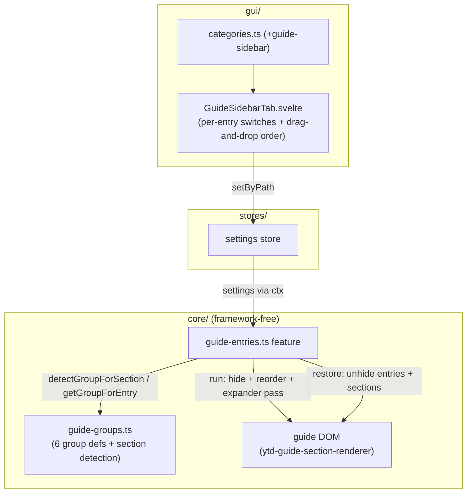
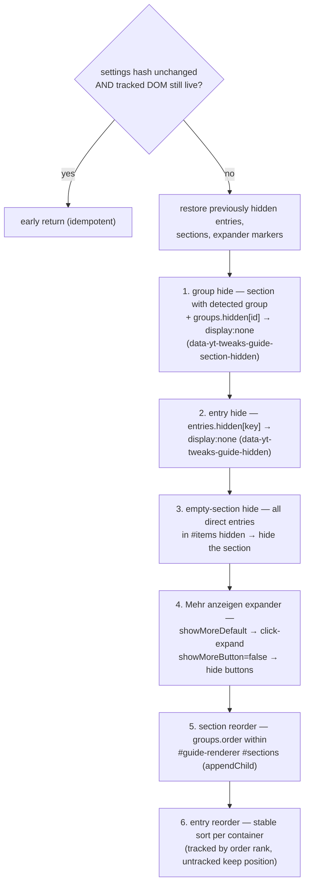
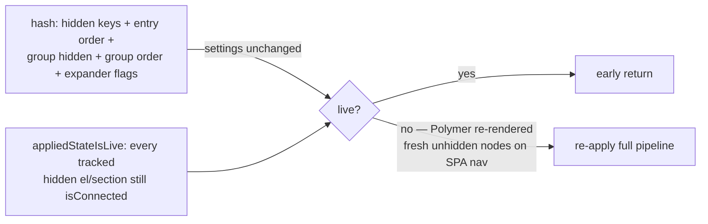
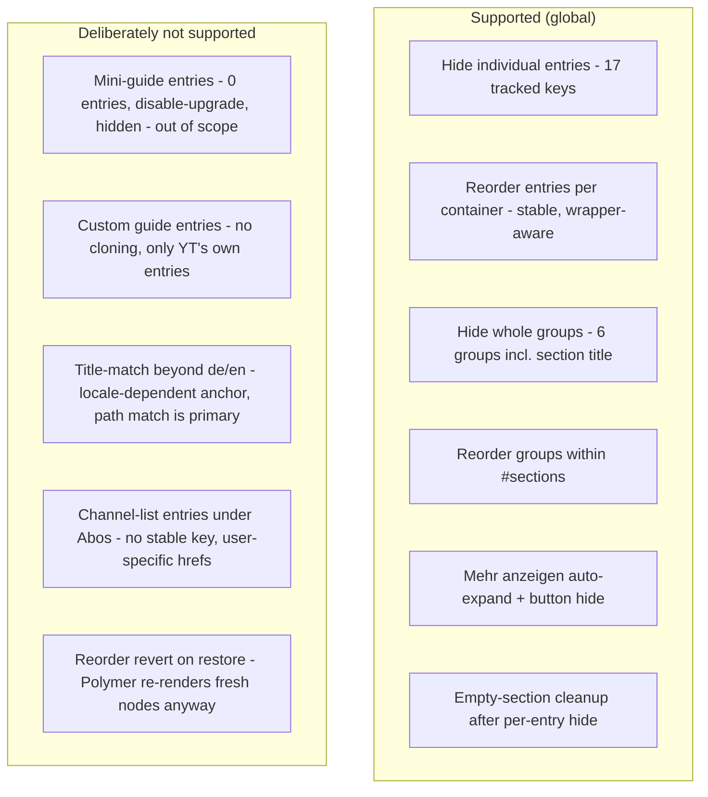

# Architecture: Guide-Entries Feature

> Hide + reorder YouTube's own guide sidebar entries (and whole entry groups/sections) via
> DOM moves — analogous to the masthead custom buttons, but applied to YT's guide. Also
> controls the "Mehr anzeigen" expander. Active globally (`*`). Diagrams depict
> relationships, structure, and boundaries — no implementation details.

## Component Structure



## Entry Detection (4 Strategies)

YT uses heterogeneous hrefs, so an entry key resolves through four strategies in order:

```mermaid
flowchart TB
  Entry["ytd-guide-entry-renderer<br/>(excludes #expander-item / #collapser-item / role=button)"]
  Entry --> H{"1. hostname match"}
  H -->|"studio / music / kids.youtube.com"| Ext["myVideos / ytMusic / ytKids"]
  H -->|miss| P{"2. path match"}
  P -->|"/" or "/feed/..." etc.| Path["home, subscriptions, history, ...<br/>(17 known keys via GUIDE_ENTRY_KEYS)"]
  P -->|miss| T{"3. title match"}
  T -->|Shorts has no href - localized titles only| Title["shorts, music, moviesShows, live<br/>(de/en only — locale-dependent fallback)"]
  T -->|miss| S4{"4. parent-section match"}
  S4 -->|"under /feed/you section + /@user href"| Chan["myChannel (user-specific)"]
  S4 -->|no match| Null["null → untracked, left alone"]
```

Shorts has no href in the fixture — only `title="Shorts"`. `myChannel` is user-specific
(`/@user`). The title strategy is YT-localized and only reliable for de/en; path matching
is the primary strategy.

## Run Pipeline



- **Group model** (guide-groups.ts): 6 groups — main, subscriptions, myYouTube,
  moreFromYT, discover, system — each detected via a signature entry (specific groups
  before generic ones to avoid false matches). Detected sections carry
  `data-yt-tweaks-guide-group`.
- **Entry reorder** ("movable unit" rule, Bug 2): the unit is the entry itself or its
  enclosing wrapper (e.g. `ytd-guide-downloads-entry-renderer`), found by climbing to the
  direct child of `#items`/`#section-items`/`#expanded`. Wrapper entries sort together
  with flat siblings; non-tracked units (e.g. the expander) keep their relative position
  via stable sort.
- **Expander flags are independent**: `showMoreDefault` controls the expanded state,
  `showMoreButton` the button's visibility — both active means expanded + button hidden.
  Titles are YT-localized ("Mehr anzeigen"/"Weniger anzeigen" vs "Show more"/"Show less",
  keyed off `ctx.locale`).

## Idempotency + SPA Liveness



A settings-only hash cannot detect that Polymer re-rendered the guide with fresh,
unhidden nodes; the DOM-liveness check (`isConnected` on tracked elements) can.

**Restore**: un-hides tracked entries/sections and clears expander markers. The reorder
is NOT reverted — Polymer renders fresh nodes in native order on SPA navigation.

## Scope Boundaries



## References

- Feature: `src/lib/core/features/guide-entries.ts`
- Helper: `src/lib/core/features/guide-groups.ts` (not a registered feature — group defs + section detection)
- Settings: `src/lib/core/settings.ts` (`GuideSettings.entries` — hidden map + order + groups)
- GUI: `src/lib/gui/tabs/GuideSidebarTab.svelte`
- Tests: `src/lib/core/__tests__/guide-entries.fixture.test.ts` (fixture-skipped), `src/lib/core/__tests__/guide-group-diag.test.ts`, `src/lib/core/__tests__/guide-migration.test.ts`

Verified: 2026-10-24 — against `src/lib/core/features/guide-entries.ts`, `src/lib/core/features/guide-groups.ts`, `src/lib/core/settings.ts` (GuideSettings.entries nested slice), `src/lib/gui/tabs/GuideSidebarTab.svelte` @ working tree (re-checked 2026-10-25 after the ADR 0007 defaults change: DEFAULT_SETTINGS.guide.entries now ships curated non-empty order arrays — all 18 entry keys + all 6 group ids verified against GUIDE_ENTRY_KEYS/GUIDE_GROUPS; resolver logic unchanged; settings.ts comment-only re-pass, no behavior change)
