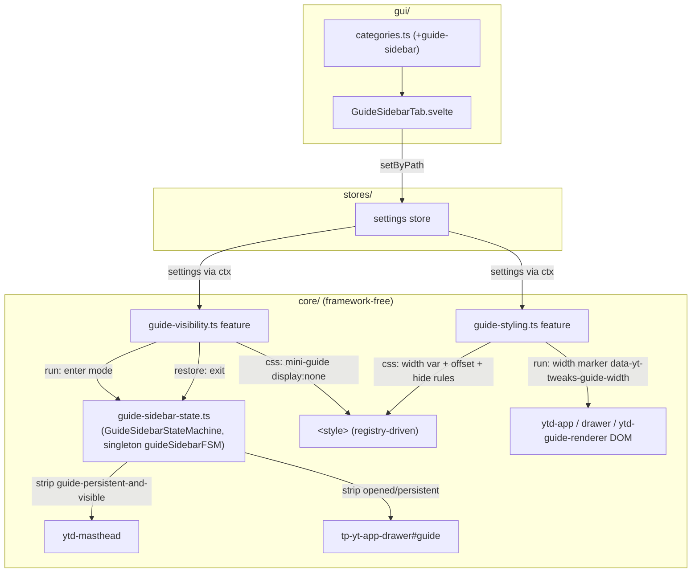
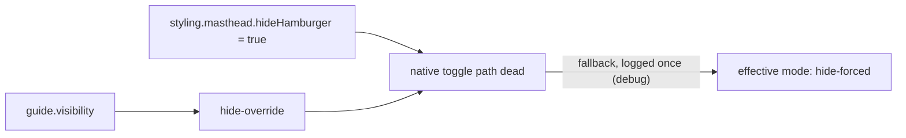
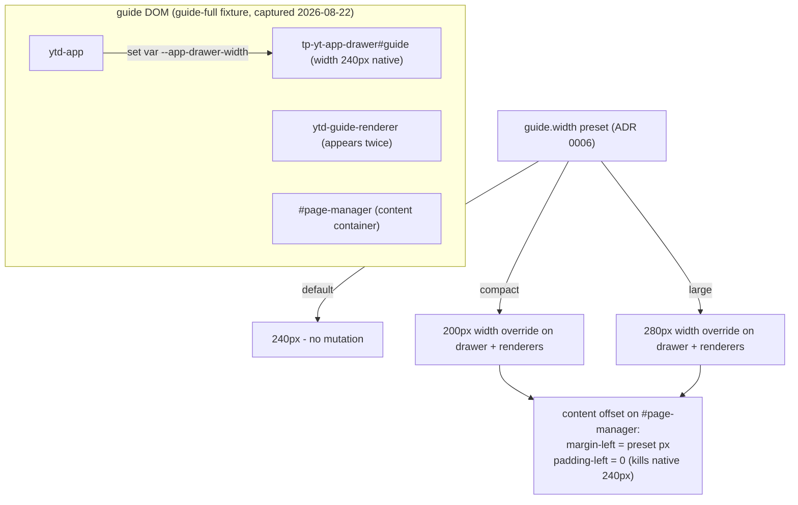
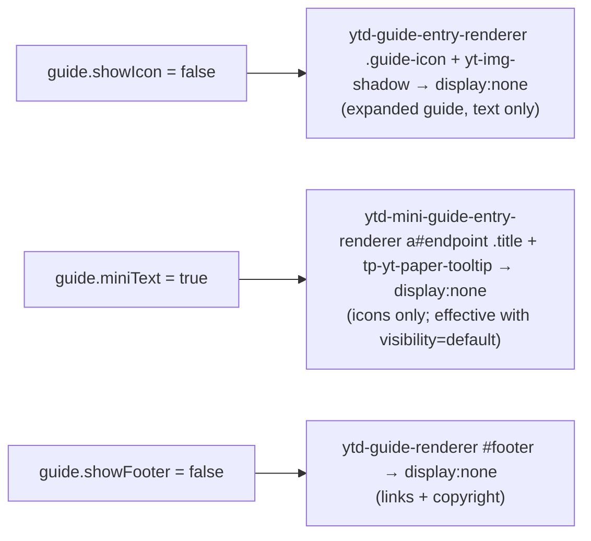

# Architecture: Guide-Sidebar Features (Visibility + Styling)

> Left sidebar pane (guide + mini-guide) control, category "guide-sidebar": one settings
> slice (`guide`), two features. `guide-visibility` drives pane visibility (CSS + an
> attribute FSM); `guide-styling` drives width presets, icon/text/footer visibility (pure
> CSS + width markers). Both apply globally (`*`). The hamburger ICON belongs to the
> masthead features — this component owns only the pane. Diagrams depict relationships,
> structure, and boundaries — no implementation details.

## Component Structure



## Visibility FSM

```mermaid
stateDiagram-v2
  [*] --> inactive
  inactive --> default : enter(default)
  inactive --> hideForced : enter(hide-forced)
  inactive --> hideOverrideClosed : enter(hide-override)
  state hideForced {
    [*] -> stripped
    stripped -> stripped : no observer, no toggle
  }
  hideForced --> inactive : exit()
  hideOverrideClosed --> hideOverrideOpened : attr set by YT native toggle
  hideOverrideOpened --> hideOverrideClosed : attr removed by YT native toggle
  hideOverrideClosed --> inactive : exit()
  hideOverrideOpened --> inactive : exit()
  default --> inactive : exit()
```

- **hide-forced**: `enter()` removes `guide-persistent-and-visible` from `ytd-masthead`
  AND `opened`/`persistent` from `tp-yt-app-drawer#guide` — YT's native JS layout then
  collapses drawer + content shift itself. `display:none` on the drawer was deliberately
  NOT used (it would break YT's reflow). Only the mini-guide is hidden via CSS.
- **hide-override**: attribute removed once (guide starts closed); a read-only
  MutationObserver on `guide-persistent-and-visible` mirrors YT's native hamburger toggle
  into the FSM state (state-sync only — no re-stripping, YT may win).
- **No click interceptor**: YT's native toggle runs through untouched (Phase 8 decision).

**Conflict resolution** (in the feature, not the FSM — the FSM does not know
`hideHamburger`):



## Width Presets + Content Offset



**Why `padding-left: 0` + `margin-left`**: YT natively pads `#page-manager` by 240px.
Setting margin in addition would double the offset; setting only the width leaves a gap.
Killing the native padding and setting our own margin makes the total offset exactly the
preset — no doubling.

**Why the `:has(#guide[opened])` scope**: a static margin kept the offset when the drawer
collapsed (Bug 4 — the freed space stayed empty). The offset now applies only while the
drawer is open. When collapsed AND `visibility` is `hide-override`/`hide-forced`
(mini-guide `display:none`), the offset is forced to 0 — YT's native 72px collapsed
offset would leave a gap next to an invisible mini-guide (Bug 4b). With `visibility:
default` the visible mini-guide keeps YT's native collapsed offset.

## Styling Toggles



Specificity note: hiding mini-guide titles anchors on `a#endpoint` (id selector) — YT's
ShadyCSS scoped rule beats a plain `.title` at equal `!important`.

## Scope Boundaries

```mermaid
flowchart TB
  subgraph Supported["Supported (global)"]
    A1[visibility default / hide-override / hide-forced]
    A2[conflict fallback hideHamburger + hide-override → hide-forced]
    A3[width presets compact 200px / large 280px (ADR 0006)]
    A4[content offset without double-offset or collapse gap]
    A5[hide expanded-guide entry icons]
    A6[mini-guide text hide - icons only]
    A7[guide footer hide]
  end

  subgraph NotSupported["Deliberately not supported"]
    B1[Free-form width slider - preset enum replaces it (ADR 0006)]
    B2[Resize-event-based width - triggered YT layout JS and hid the guide]
    B3[display:none on the drawer - breaks YT's native content-shift reflow]
    B4[Hamburger icon hiding - masthead features scope]
    B5[Entry hide/reorder - guide-entries.md scope]
  end
```

## References

- Features: `src/lib/core/features/guide-visibility.ts`, `src/lib/core/features/guide-styling.ts`
- Helper: `src/lib/core/guide-sidebar-state.ts` (FSM — not a feature, singleton `guideSidebarFSM`)
- Settings: `src/lib/core/settings.ts` (`GuideSettings`, `GuideVisibility`, `GuideWidthPreset`)
- GUI: `src/lib/gui/tabs/GuideSidebarTab.svelte`
- Tests: `src/lib/core/__tests__/guide-sidebar-state.test.ts` (FSM enter/observer/exit/re-enter), `src/lib/core/__tests__/guide-migration.test.ts` (menuSidebarMode → hideHamburger + visibility; width sliders → presets)
- Decisions: [ADR 0006](../adr/0006-preset-enums-over-freeform-css-inputs.md)

Verified: 2026-10-24 — against `src/lib/core/features/guide-visibility.ts`, `src/lib/core/features/guide-styling.ts`, `src/lib/core/guide-sidebar-state.ts`, `src/lib/core/settings.ts` (`GuideSettings`), `src/lib/gui/tabs/GuideSidebarTab.svelte` @ working tree (re-checked 2026-10-25 after the ADR 0007 defaults change: DEFAULT_SETTINGS.guide now ships visibility "hide-override", width "large", miniText true, showMoreDefault true, showFooter false — FSM + CSS logic unchanged; settings.ts comment-only re-pass, no behavior change)
