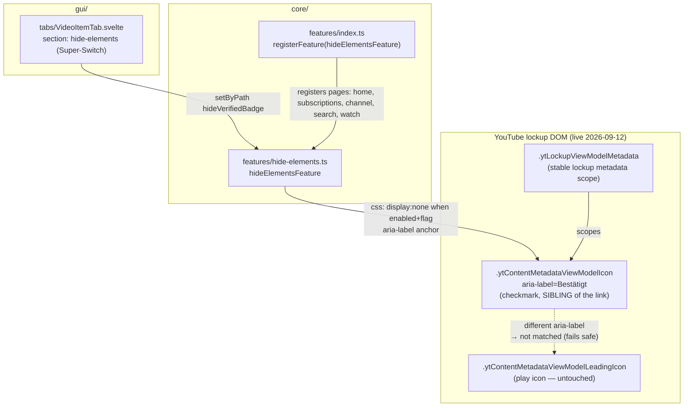

# hide-elements — Architecture

Hides YouTube-native elements inside video-card lockups (starting with the verified
checkmark next to the channel name) via pure CSS on all lockup pages. Diagrams depict
relationships, structure, and boundaries — no implementation details.

## Component Structure



## Anchor: aria-label, not structure (bug #12 fix)

The live DOM (user-reported 2026-09-12) renders the verified checkmark as a **sibling** of
the channel-name link — `span.ytContentMetadataViewModelIcon[aria-label="Bestätigt"]` —
NOT inside the link as the 3-week-old fixture showed (`ytAttributedStringInlineBlockMod`).
The aria-label is the exact semantic anchor: YouTube ships it with the verified badge,
it is locale-locked to the content language (de "Bestätigt"; en presumably "Verified" —
`?` open: add the en label after live verification).

**Music-note co-hide: RESOLVED for live grid rows.** The old slot-based hide also caught
the music note (same InlineBlockMod slot, empty aria-label). The aria-label anchor
discriminates: an unlabeled icon is simply not matched — the feature fails safe instead of
over-hiding. The compound selector covers both content locales: de `Bestätigt`
(live-verified) and en `Verified` (well-known YT string — fails safe if it drifts: an
unmatched label hides nothing).

## Scope Boundaries

```mermaid
flowchart TB
  subgraph Supported["Supported (hide-elements)"]
    S1[Verified checkmark hide via aria-label anchor - pure CSS]
    S2[All lockup pages: home, subscriptions, channel, search, watch sidebar]
    S3[Extensible hide group - future hides slot in as boolean rules]
  end
  subgraph NotSupported["Deliberately not supported"]
    N1[Watch-page owner row + channel header checkmark - different DOM, later capture]
    N2[Unlabeled icon hides - aria-label anchor only, fails safe (music note stays)]
    N3[DOM-pass hides - pure CSS only, ADR 0001 re-render-safety]
    N4[en-locale aria-label - covered via compound selector (Verified), fails safe]
  end
```

## References

- Feature: `src/lib/core/features/hide-elements.ts`
- Settings: `src/lib/core/settings.ts` (`HideElementsSettings`, `DEFAULT_SETTINGS.hideElements`)
- GUI: `src/lib/gui/tabs/VideoItemTab.svelte` (section `hide-elements`),
  `src/lib/gui/navigation/categories.ts` (video-item sections)
- Tests: `src/lib/core/__tests__/hide-elements.test.ts` (incl. selector verification
  against the captured home-grid DOM), `e2e/tests/css-injection.spec.ts`
- Decision record: [ADR 0001 — marker attribute over inline style](../adr/0001-marker-attribute-over-inline-style.md)
  (why pure CSS instead of a DOM pass)
- DOM fixtures: `src/lib/core/__fixtures__/home-grid-item.fixture.html`,
  `src/lib/core/__fixtures__/watch-recommendations.fixture.html` (captured 2026-08-23)

Verified: 2026-10-19 — against `src/lib/core/features/hide-elements.ts` (compound `["Bestätigt", "Verified"]` aria-label selector), `src/lib/core/settings.ts` (`HideElementsSettings`), `src/lib/gui/tabs/VideoItemTab.svelte` (section `hide-elements`) @ working tree (re-checked 2026-10-24 after the meta-split change: feature + slice untouched; re-checked 2026-10-25 after the wording pass: VideoItemTab lost only the hideVerifiedBadge Field `desc` prop — path + Super-Switch structure unchanged; re-checked 2026-10-25 after the ADR 0007 defaults change: DEFAULT_SETTINGS.hideElements now ships hideVerifiedBadge true — selector + gating unchanged; settings.ts comment-only re-pass, no behavior change)
