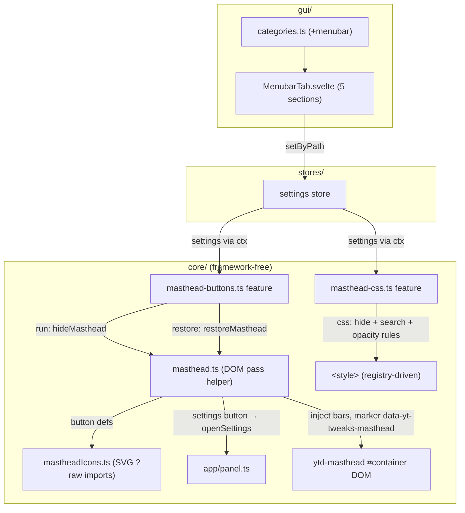
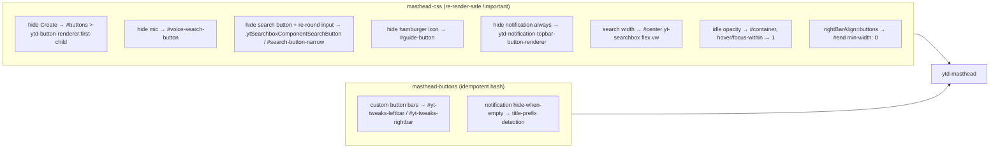
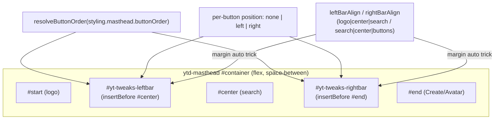
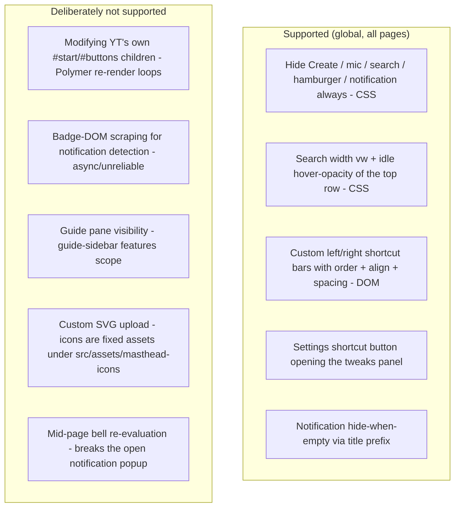

# Architecture: Masthead (Topbar) Features

> Topbar (`ytd-masthead`) tweaks, category "Menubar": one category, two features sharing
> the `styling.masthead` settings slice and one super-switch. `masthead-css` is the pure-CSS
> feature (hide buttons, search styling, hover opacity); `masthead-buttons` is the DOM-pass
> feature (custom shortcut bars, empty-notification hiding). Both apply globally (`*`) —
> the masthead exists on every page. Diagrams depict relationships, structure, and
> boundaries — no implementation details.

## Component Structure



## CSS vs DOM-Pass Split



**Why the split**: everything targetable by a stable selector is pure CSS. The two DOM
cases need JS: custom buttons must be built from scratch (icons via Vite `?raw` SVG
imports, locale-aware labels), and empty-notification detection reads `document.title`
(prefix `(N) `) — far more reliable than scraping the badge DOM, which Polymer re-renders
asynchronously.

**Hamburger vs guide pane**: `hideHamburger` hides only the `#guide-button` icon — the
guide pane itself is the guide-sidebar features' scope. When both are active, guide
conflict resolution handles the dead toggle path (see guide-sidebar.md).

## Custom Button Bars



- **Buttons**: history, subscriptions, playlists, watchLater, likedVideos, myVideos,
  downloads, settings — each `none | left | right`. Labels are locale-aware (de/en) via
  `PageCtx.locale`; the locale is part of the idempotency hash so a content-language switch
  re-renders labels.
- **Navigation**: a custom button clicks YT's own guide link
  (`a.yt-simple-endpoint[href=...]`) — Polymer SPA navigation — with `window.location.href`
  as fallback. The settings button opens the tweaks panel (`openSettings`) instead.
- **Why separate bars, not `#start`/`#buttons`**: inserting into YT's flex slots collided
  with the Create button and Polymer re-render loops. The bars are light-DOM flex children
  of `#container`, positioned by insertion order + the margin-auto trick against
  `space-between`.
- **Idempotency**: hash over button positions + order + spacings + aligns + locale; bars
  are never removed, only `display:none` when empty — otherwise the existence check in
  the early return would re-inject in a loop.

## Empty-Notification Hide

```mermaid
sequenceDiagram
  participant Run as hideMasthead (run)
  participant Title as document.title
  participant Bell as ytd-notification-topbar-button-renderer

  Note over Run: hideNotification == "empty" → register once
  Run->>Run: addEventListener yt-navigate-finish + popstate
  Run->>Title: regex ^\(\d+\)\s
  alt no (N) prefix → empty
    Run->>Bell: set data-yt-tweaks-notif-empty (CSS hides)
  else (N) prefix present
    Run->>Bell: remove attr (un-hide)
  end
  Note over Run, Bell: re-evaluated ONLY on SPA nav (path change) — a mid-page re-eval would hide the bell while the notification popup is open (title clears when the user reads)
```

## Scope Boundaries



## References

- Features: `src/lib/core/features/masthead-css.ts`, `src/lib/core/features/masthead-buttons.ts`
- Helper: `src/lib/core/masthead.ts` (DOM pass — not a feature, consumed by masthead-buttons)
- Icons: `src/lib/core/mastheadIcons.ts` (SVGs from `src/assets/masthead-icons/history.svg` etc.)
- Settings: `src/lib/core/settings.ts` (`MastheadSettings`)
- Panel hook: `src/lib/app/panel.ts` (`openSettings`)
- GUI: `src/lib/gui/tabs/MenubarTab.svelte`
- Tests: `src/lib/core/__tests__/masthead-migration.test.ts` (settings migration; DOM run manually verified against the masthead fixture)

Verified: 2026-10-24 — against `src/lib/core/features/masthead-css.ts`, `src/lib/core/features/masthead-buttons.ts`, `src/lib/core/masthead.ts`, `src/lib/core/mastheadIcons.ts`, `src/lib/core/settings.ts`, `src/lib/gui/tabs/MenubarTab.svelte` @ working tree (re-checked 2026-10-25: `src/assets/masthead-icons/settings.svg` path data replaced with the correct Material `auto_fix_high` 24px silhouette — the previous path was corrupted (coordinates outside the 0 0 24 24 viewBox); structure unchanged: single-path SVG, parsed by `parseSvg`; re-checked 2026-10-25 after the ADR 0007 defaults change: DEFAULT_SETTINGS.styling.masthead now ships the curated baseline — hideCreateButton/hideMicButton/hideSearchButton true, searchWidthPct 30, history/subscriptions/watchLater "left", settings "right", reordered buttonOrder, rem spacings 1.3/0.25/1.3 — bar construction/align/hash logic unchanged; settings.ts comment-only re-pass, no behavior change)
