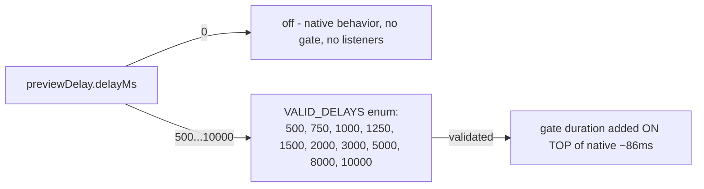
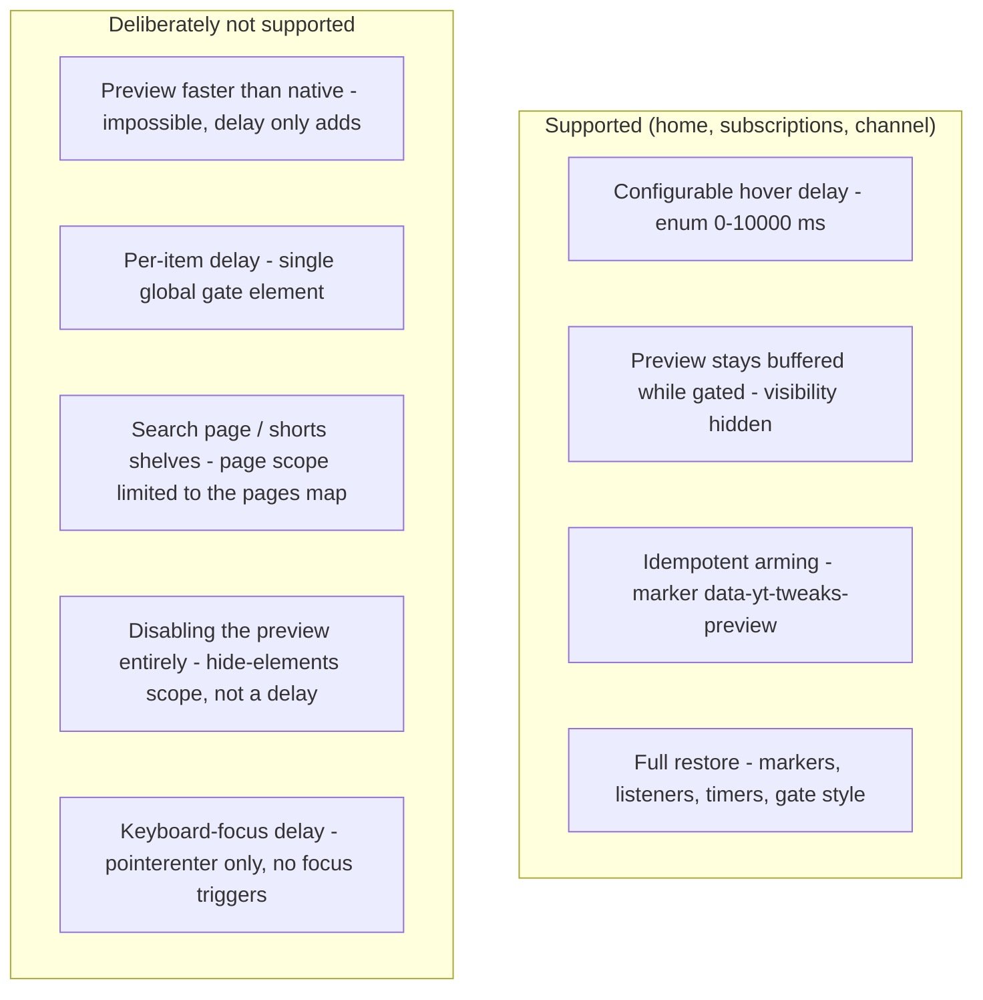

# Architecture: Preview-Delay Feature

> Delays YouTube's inline hover-preview player (`#video-preview`) by a configurable
> duration added on top of YT's native ~86ms hover→video delay. The first JS-listener
> feature in the codebase: per-item `pointerenter` timers control a dedicated CSS gate.
> Active on home, subscriptions, and channel grid pages. Diagrams depict relationships,
> structure, and boundaries — no implementation details.

## Component Structure

```mermaid
flowchart TB
  subgraph GUI["gui/"]
    Tab["VideoItemTab.svelte (section preview-delay)"]
    Nav["categories.ts (+video-item)"]
  end

  subgraph Store["stores/"]
    S["settings store"]
    V["validation store"]
  end

  subgraph Core["core/ (framework-free)"]
    FEAT["preview-delay.ts feature"]
    FEAT -->|validate: delayMs enum| V
    FEAT -->|css: returns [] (self-managed gate)| Registry["registry css aggregation"]
    FEAT -->|run: arm pointerenter listeners| DOM["ytd-rich-item-renderer items"]
    FEAT -->|restore: markers, listeners, timers, gate| DOM
    Gate["&lt;style id=\"yt-tweaks-preview-gate\"&gt; (self-managed)"]
    FEAT -->|applyGate / liftGate| Gate
    Gate -->|visibility hidden| Preview["#video-preview"]
  end

  Tab -->|setByPath| S
  S -->|settings via ctx| FEAT
  Nav --> Tab
```

**Why a self-managed gate `<style>` instead of the registry stylesheet**: the registry
re-emits `css()` output on every throttled observer pass; a flag-based gate rule would be
clobbered or re-applied at wrong moments. The feature therefore owns a dedicated
`<style id="yt-tweaks-preview-gate">` it injects/removes directly; `css()` returns `[]`.

## Hover Gate Mechanism

```mermaid
sequenceDiagram
  participant User as pointer
  participant Item as ytd-rich-item-renderer<br/>(marker data-yt-tweaks-preview)
  participant Gate as gate &lt;style&gt;
  participant Timer as setTimeout(delayMs)

  Note over Item: run() armed the item (capture-phase pointerenter)
  User->>Item: pointerenter
  Item->>Timer: clear ALL pending timers (global gate)
  Item->>Gate: applyGate (visibility: hidden !important)
  Item->>Item: marker → pending
  Item->>Timer: start setTimeout(delayMs)
  Timer->>Gate: liftGate (preview becomes visible)
  Item->>Item: marker → shown
  Note over Gate: no pointerleave re-arm — the preview overlay intercepts pointer events. A leave handler would re-hide the just-shown preview → stuck
  User->>Item: next pointerenter (any item)
  Item->>Gate: re-apply gate, restart delay
```

**Why `visibility: hidden` instead of `display: none`**: the preview stays in the render
tree while gated — YT's `<video>` can buffer during the delay, so the preview appears
instantly when the gate lifts.

**Why no `pointerleave`**: the inline preview runs as a separate overlay that intercepts
pointer events once visible (same overlay rationale as dim-watched's hoverReveal). A
leave handler would fire the instant the overlay shows → gate re-applied → preview
vanishes → permanently stuck. The gate is re-armed only on the next `pointerenter`.

**Why `run()` checks `gateLifted`**: the throttled MutationObserver calls `run()` on every
scroll/lazy-load batch. A blind `applyGate()` would re-hide a preview that is currently
showing after its timer fired. The module-level `gateLifted` flag stays true until the
next pointerenter resets it.

**Why every enter clears ALL timers**: the gate is a single global element. Hovering item
A, then moving to B: A's remaining timer would lift the gate mid-delay and show B's
preview early. Clearing the whole timer map on each enter restarts the delay cleanly.

## Delay Enum



Enum values over free-form input — layout-invariant decision, see
[ADR 0006](../adr/0006-preset-enums-over-freeform-css-inputs.md). The delay can only ADD
to the native delay; it cannot make the preview appear faster than native.

## Scope Boundaries



## References

- Feature: `src/lib/core/features/preview-delay.ts`
- Settings: `src/lib/core/settings.ts` (`PreviewDelaySettings`: enabled, delayMs — VALID_DELAYS enum)
- Overlay rationale sibling: `src/lib/core/features/dim-watched.ts` (hoverReveal)
- GUI: `src/lib/gui/tabs/VideoItemTab.svelte`
- Tests: `src/lib/core/__tests__/preview-delay.test.ts` (VALID_DELAYS, validate, CSS contract, feature metadata)

Verified: 2026-10-24 — against `src/lib/core/features/preview-delay.ts`, `src/lib/core/settings.ts`, `src/lib/gui/tabs/VideoItemTab.svelte` @ working tree (re-checked 2026-10-25 after the wording pass: VideoItemTab field wiring unchanged — only i18n label strings elsewhere; re-checked 2026-10-25 after the ADR 0007 defaults change: DEFAULT_SETTINGS.previewDelay now ships enabled true + delayMs 1250 — gate/lifter logic + VALID_DELAYS unchanged; settings.ts comment-only re-pass, no behavior change)
