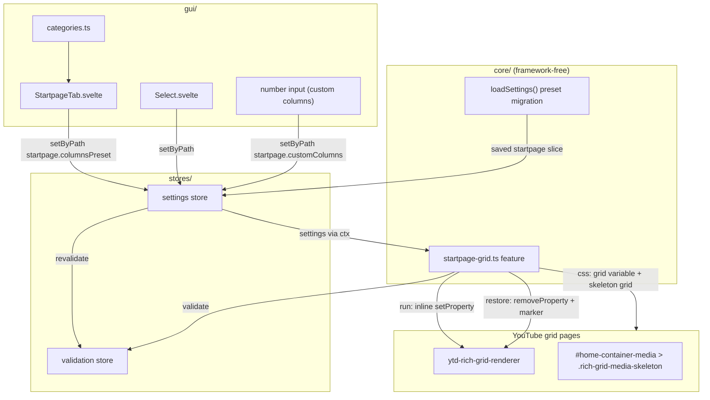
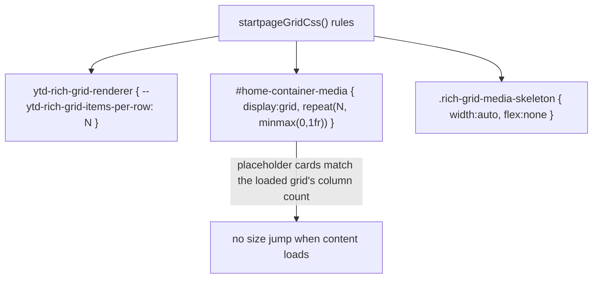

# Architecture: Startpage Grid Columns

> Overrides the number of video columns on YouTube's grid pages (home, subscriptions,
> channel) via the CSS variable `--ytd-rich-grid-items-per-row` on
> `ytd-rich-grid-renderer`, plus an inline JS pass so Polymer re-layouts reliably.
> Diagrams depict relationships, structure, and boundaries — no implementation details.

## Component Structure



## Column Count Resolution (Enum + Custom)

```mermaid
flowchart LR
  Preset["startpage.columnsPreset (enum)"]
  Preset -->|default| Native["no override (YT-native responsive)"]
  Preset -->|"1"–"10"| Fixed["fixed count via PRESET_COLUMNS map"]
  Preset -->|custom| Custom["customColumns, clamped [1,10]"]
  Custom -->|validator| Err["validation error when non-integer or outside [1,10]"]
  Fixed --> CSS["--ytd-rich-grid-items-per-row: N"]
  Custom --> CSS
  CSS --> Inline["run(): inline style on ytd-rich-grid-renderer + marker"]
```

Why the inline pass exists alongside the stylesheet: YouTube's Polymer reads the grid
column count from the element's inline custom property, not from the computed
stylesheet value. A global `<style>` rule with `!important` does not reliably reach
Polymer's scoped property resolution, so SPA page switches and preset changes would
not re-layout. The inline `setProperty` triggers Polymer's property observer; the
MutationObserver (observer.ts) re-applies it on lazy-loaded grids and re-renders.

## Skeleton Sync (No Reflow on Load)



## Preset Migration (loadSettings)

Saved adjective presets from the earlier iteration (`small`/`large`/`xlarge`) map to
their numeric equivalents (`"2"`/`"4"`/`"5"`) once on load; `"default"`, `"custom"`,
and `customColumns` pass through untouched. The removed `fixHeightByColumns` field is
not mapped — `deepMerge` copies only keys present in `DEFAULT_SETTINGS`, so stale
saved keys are silently dropped.

## Scope Boundaries

```mermaid
flowchart TB
  subgraph Supported["Supported"]
    A1[home / subscriptions / channel pages]
    A2[Fixed column count 1-10 via preset]
    A3[Custom numeric column count 1-10]
    A4[Skeleton placeholder column sync]
    A5[Migration of legacy adjective presets]
  end

  subgraph Deliberately["Deliberately not supported"]
    B1[Responsive breakpoints - one fixed count, not per-width (out of scope)]
    B2[Item width/height fixing - fixHeightByColumns removed, did not behave as desired]
    B3[Shelf items - only real video lockups are affected by the grid variable]
    B4[Watch page - different layout, no rich grid]
  end

  subgraph Kept["Kept by explicit human decision"]
    C1[customColumns number input - redundant to the 1-10 enum, kept as an alternative input path]
  end
```

## References

- Feature: `src/lib/core/features/startpage-grid.ts`
- Settings: `src/lib/core/settings.ts`
- GUI: `src/lib/gui/tabs/StartpageTab.svelte`
- Tests: `src/lib/core/__tests__/startpage-grid.test.ts`, `src/lib/core/__tests__/startpage-migration.test.ts`
- Related docs: `docs/architecture/feature-registry.md`, `docs/architecture/gui-navigation.md`

Verified: 2026-10-19 — against `src/lib/core/features/startpage-grid.ts`, `src/lib/core/settings.ts` (preset migration `small/large/xlarge` → `"2"/"4"/"5"`), `src/lib/gui/tabs/StartpageTab.svelte` @ working tree (re-checked 2026-10-24 after the meta-split change: feature + slice untouched; re-checked 2026-10-25: only the related doc gui-navigation.md changed — startpage feature, slice and StartpageTab untouched; re-checked 2026-10-25 after the ADR 0007 defaults change: DEFAULT_SETTINGS.startpage now ships enabled true + columnsPreset "7" + customColumns 6 — PRESET map + custom-variable CSS unchanged; settings.ts comment-only re-pass, no behavior change)
