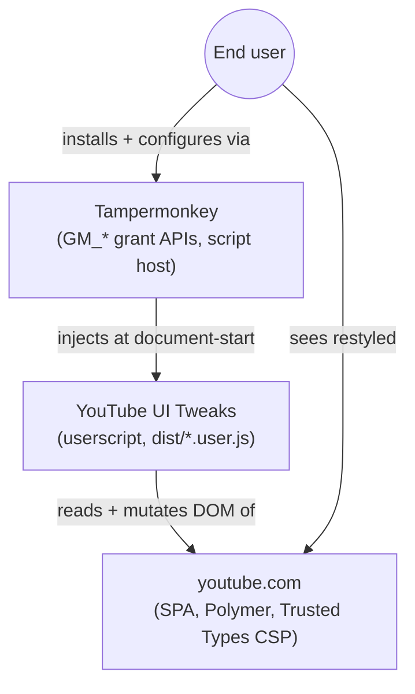
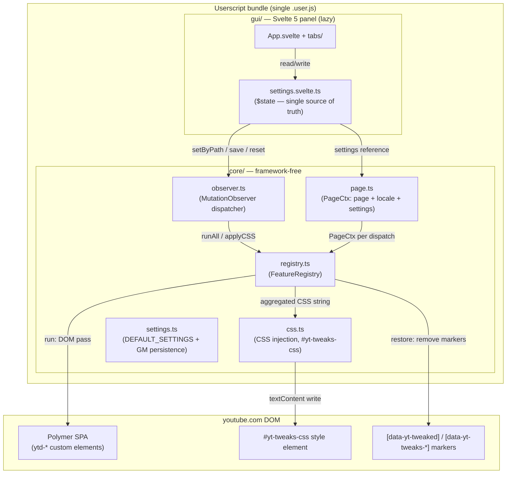
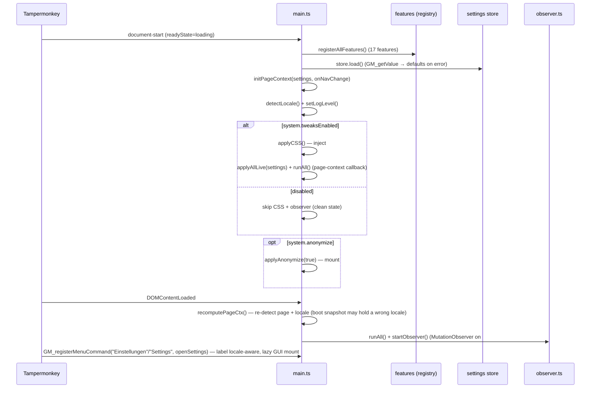

# Architecture: System Overview

> The YouTube UI Tweaks userscript: a Tampermonkey script that restyles YouTube's DOM via a
> registry of self-registering features, plus a lazily-mounted Svelte settings panel. This doc
> is the top-level map — read it first. Diagrams depict relationships, structure, and
> boundaries; selectors and element ids are part of those boundaries.

## System Context (C4 Level 1)



**Environment constraints that shape the architecture:**

- YouTube enforces `require-trusted-types-for 'script'` — no `innerHTML` sinks; Svelte's
  imperative DOM APIs are the reason the panel is Svelte 5.
- `@run-at document-start` runs before `document.head`/`document.body` exist — CSS injection
  falls back to `documentElement`; the GUI must mount lazily.
- YouTube is an SPA: page changes happen without reload (`yt-navigate-finish` events);
  Polymer re-renders mutate the DOM under our feet — the MutationObserver is the backstop.

## Container Diagram (C4 Level 2)



**Two-part split (the load-bearing boundary):** `core/` is framework-free DOM logic that runs
at `document-start`; `gui/` is the Svelte panel that mounts only when the user opens settings.
Core never imports Svelte; the GUI reads and writes the store, and the store notifies the
observer pipeline.

## Boot Sequence



**Why registration precedes CSS generation**: `applyCSS` asks the registry to generate the
feature-driven CSS (`generateCSS(settings, ctx)`); an empty registry would emit an empty
stylesheet. PageCtx initialization precedes it for the same reason — features are dispatched
per page.

**Why the page-change callback reads `store.settings` live**: `reset()`/`importJson()`
REPLACE the settings object — a stale boot-time capture would re-apply old CSS after the
new state was already applied.

## Data Flow: Store ↔ Observer ↔ Registry

```mermaid
flowchart LR
  GUI["GUI components<br/>(read $derived, write setByPath)"]
  Store["settings.svelte.ts<br/>$state — single source of truth"]
  Obs["observer.ts"]
  Reg["registry.ts"]
  DOM["YouTube DOM<br/>(#yt-tweaks-css + markers)"]

  GUI -->|setByPath| Store
  Store -->|setCurrentSettings| Obs
  Store -->|scheduleLiveApply settings, changedKey| Obs
  Obs -->|runAll ctx| Reg
  Obs -->|generateCSS → injectCSS| DOM
  Reg -->|run: DOM passes (throttled 200ms, idle callback)| DOM
  Mutation["MutationObserver on #content<br/>(childList, subtree)"] -->|throttledRunAll| Obs
  SPANav["yt-navigate-finish / popstate<br/>(PageCtx re-detect)"] -->|page or locale changed → applyAllLive + runAll| Obs
```

**Ownership rule**: the store owns the state; the observer owns the timing (throttle with
leading+trailing edge and max-wait — a pure trailing debounce would never fire during
continuous scrolling); the registry owns the dispatch (which feature runs on which page);
features own the mutation (what changes in the DOM).

**Live-apply pipeline**: a settings change (`setByPath`) schedules a debounced restore+rerun
(default 150 ms) that restores only features whose `liveApplyKeys` prefix-match the changed key
(equal or child path), then regenerates CSS and re-runs all features for the current page.
`flushLiveApply` EXECUTES a pending pass immediately on save/import (never drops it);
wholesale settings replacement (reset/importJson) goes through `restoreAndRunAll(settings)`
(full restore of every feature's mutations, then re-apply).

## Page Detection (PageCtx)

```mermaid
flowchart LR
  URL["location.href"] --> Detect["detectPage(url, domProbe)"]
  DomCue["DOM cues:<br/>ytd-rich-grid-renderer → home<br/>ytd-watch-flexy → watch"] --> Detect
  Detect --> PageType["PageType: home | subscriptions | channel | watch | search | shorts"]
  Detect --> Ctx["PageCtx = page + locale + settings (immutable snapshot)"]
  Ctx -->|dispatch key pages[ctx.page] ?? pages['*']| Features
```

**Why DOM cues on top of URL**: YouTube keeps `ytd-watch-flexy` in the DOM after navigating
_away_ from watch (fast back-nav caching) — a bare presence check would false-positive
"watch" on the homepage and break home-only features. `ytd-rich-grid-renderer` exists only
on grid pages, resolving the ambiguity. `"*"` is a feature-level fallback, never a
detection result. See `feature-registry.md` for dispatch.

## Scope Boundaries

```mermaid
flowchart TB
  subgraph In["In scope (userscript)"]
    S1[CSS injection per page + feature registry dispatch]
    S2[DOM passes (text-shorten, ads-hide, button hiding) with marker-based restore]
    S3[Svelte 5 settings panel — lazy mount, Trusted-Types-safe]
    S4[GM_* persistence of one settings JSON]
  end
  subgraph Out["Deliberately out of scope"]
    N1[No adblock-style network blocking — DOM/CSS layer only]
    N2[No YouTube account interaction, no API calls]
    N3[No styling of pages other than youtube.com]
  end
```

## References

- Boot: `src/main.ts`
- Registry: `src/lib/core/registry.ts`, contracts: `src/lib/core/feature.types.ts`
- Observer: `src/lib/core/observer.ts`, page context: `src/lib/core/page.ts`
- Store: `src/lib/stores/settings.svelte.ts`
- Feature registration: `src/lib/core/features/index.ts` (17 registered features)
- Cross-cutting decisions: [docs/adr/](../adr/)

Verified: 2026-10-24 — against `src/main.ts`, `src/lib/core/{registry,observer,page,feature.types}.ts`, `src/lib/stores/settings.svelte.ts`, `src/lib/core/features/index.ts` (17 features — meta-split added; boot sequence unchanged: runAll() once, THEN startObserver()) @ working tree (re-verified after the 2026-10-24 meta-split change)
