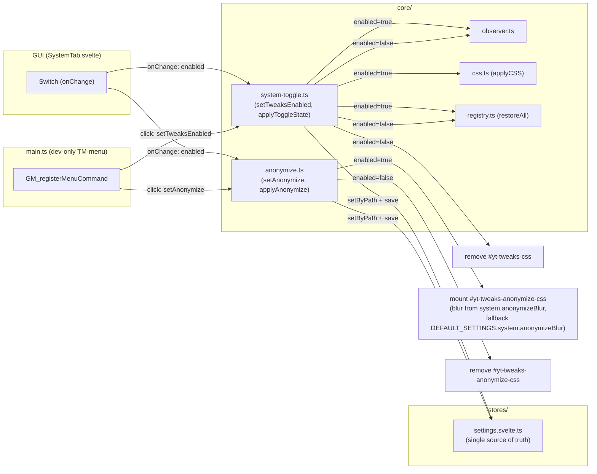
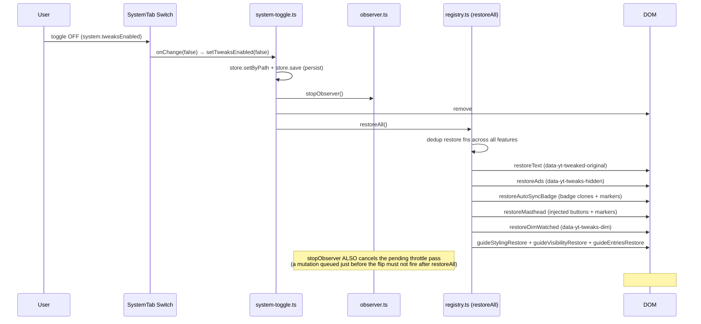
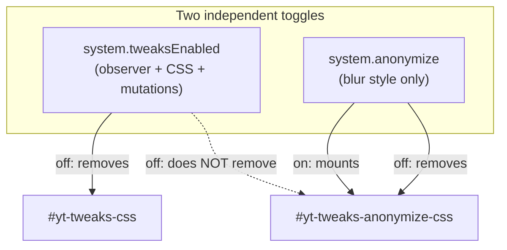

# Architecture: System Toggles + Anonymize Layer

> Toggle architecture for the global kill-switch (`system.tweaksEnabled`) and the anonymize
> layer (`system.anonymize`). Both live in the settings JSON, are UI-controllable in the System
> tab (prod + dev), and have dev-only TM-menu entries. Diagrams depict relationships, structure,
> and boundaries — no implementation details.

## Component Structure



## Kill-Switch Disable Sequence (restoreAll)



**Defense-in-depth kill-switch gating**: `observer.runOnce`/`runAll` additionally check
`system.tweaksEnabled` themselves — a pass scheduled before `setTweaksEnabled(false)`
(idle callback, throttle trailing edge, live-apply timer racing the toggle) returns early
instead of re-mutating the already-restored "clean" DOM.

**Wholesale settings replacement (reset/importJson)**: the store flushes the live-apply
debounce and calls the observer's `restoreAndRunAll(settings)` — a conservative
whole-state reset (restore EVERY feature's mutations, then re-apply CSS + re-run all
features from the new settings), because there is no per-key diff for a replaced
settings object.

## Independence: Anonymize survives kill-switch-off



## Scope Boundaries

```mermaid
flowchart TB
  subgraph Supported["Supported"]
    S1[Global kill-switch — stop observer, remove CSS, restore all DOM mutations]
    S2[Anonymize layer — independent blur style, own style element]
    S3[Dev-only TM-menu entries (build:dev, __DEV_CAPTURE__-gated)]
  end
  subgraph NotSupported["Deliberately not supported"]
    N1[Per-feature kill-switches — one global switch only]
    N2[Anonymize coupling to kill-switch — independent by design]
  end
```

## References

- Toggle logic: `src/lib/core/system-toggle.ts`, `src/lib/core/anonymize.ts`
- Registry restore: `src/lib/core/registry.ts` (`restoreAll`)
- Kill-switch gating + whole-state reset: `src/lib/core/observer.ts` (`restoreAndRunAll`, tweaksEnabled checks in `runOnce`/`runAll`)
- Store reset/import path: `src/lib/stores/settings.svelte.ts` (`reset`, `importJson`)
- Boot wiring: `src/main.ts`
- Related doc: [feature-registry.md](feature-registry.md)

Verified: 2026-10-19 — against `src/lib/core/system-toggle.ts`, `src/lib/core/anonymize.ts` (blur fallback `DEFAULT_SETTINGS.system.anonymizeBlur`), `src/lib/core/observer.ts`, `src/lib/stores/settings.svelte.ts`, `src/main.ts` @ working tree (re-verified after kill-switch gating + restoreAndRunAll changes; re-checked 2026-10-25 after the ADR 0007 defaults change: anonymize.ts blur-fallback comment now points at the curated DEFAULT_SETTINGS.system.anonymizeBlur (4) instead of a hard-coded 12 — mount/blur logic unchanged)
