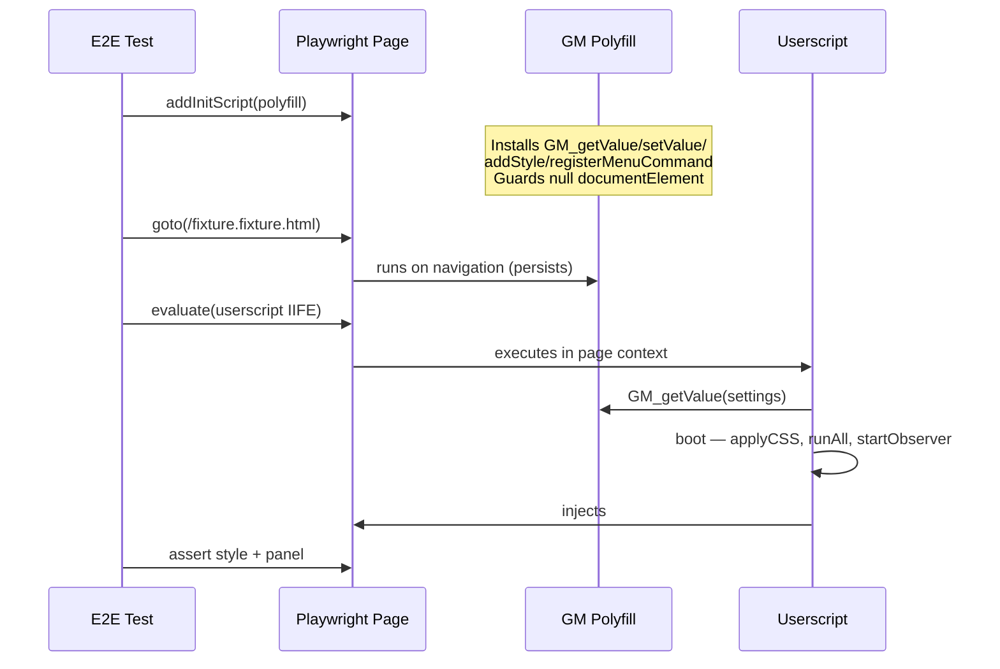
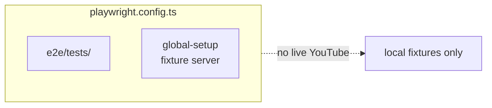

# Architecture: Testing Layers

> Test architecture for the YouTube UI Tweaks userscript — three automated layers + manual verification.
> Diagrams depict relationships, structure, and boundaries — no implementation details.

## Test Layers Overview

```mermaid
flowchart TB
  subgraph Vitest["Vitest (node + jsdom)"]
    direction TB
    Pure[Pure-Logic Tests<br/>node env]
    Fixture[jsdom Fixture Tests<br/>jsdom env, describe.skipIf<br/>(!fixtureExists)]
    Pure --> CoreModules[core/*.ts<br/>pure functions]
    Fixture --> FixturesDir[__fixtures__<br/>captured DOM<br/>gitignored - privacy]
  end

  subgraph Playwright["Playwright E2E (Firefox)"]
    direction TB
    E2E[E2E Specs]
    E2E --> FixtureServer[Fixture Server<br/>http :4174]
    E2E --> PolyfillInject[GM Polyfill<br/>addInitScript]
    E2E --> UserscriptInject[Userscript<br/>evaluate after load]
    FixtureServer --> FixturesDir
    UserscriptInject --> BuiltScript[dist/*.user.js]
  end

  subgraph Capture["Tampermonkey Capture (real Firefox, manual)"]
    direction TB
    TmMenu["Capture All Fixtures"<br/>TM menu entry]
    TmMenu --> LiveYT[youtube.com<br/>real browser]
    TmMenu --> DevCapture[dev/capture.ts<br/>dev build only]
    LiveYT --> Download[Auto-download<br/>.fixture.html]
    Download --> FixturesDir
  end

  subgraph Manual["Manual Verification"]
    ObserverTest[Observer firing<br/>live-apply timing<br/>visual layout]
  end

  CoreModules --> Userscript[Userscript Logic]
  BuiltScript --> Userscript
  BuiltDevScript --> Userscript

  FixturesDir -.->|consumed by| Fixture
  FixturesDir -.->|consumed by| E2E
  FixturesDir -.->|produced by| Capture
```

## Injection Order (E2E)



## Config Separation



## When Each Layer Runs

| Layer         | Trigger                                      | Target                           | Cookies | CI-safe                  |
| ------------- | -------------------------------------------- | -------------------------------- | ------- | ------------------------ |
| Typecheck     | `npm run check` (incl. tests)                | src + tests (svelte-check + tsc) | no      | yes                      |
| Pure-logic    | `npm run test`                               | core functions                   | no      | yes                      |
| jsdom fixture | `npm run test` (skips when fixtures absent)  | captured DOM                     | no      | yes                      |
| E2E           | `npm run test:e2e` (after build, local-only) | hosted fixtures                  | no      | no (fixtures gitignored) |
| Capture       | TM menu "Capture All Fixtures"               | live YouTube (real Firefox)      | yes     | no                       |
| Manual        | human in Tampermonkey                        | live YouTube                     | yes     | no                       |

**Fixture privacy & skipping**: fixtures are real captured YouTube DOM (including personal
subscription data) — deliberately gitignored and never published. Fixture suites wrap in
`describe.skipIf(!fixtureExists(...))` (helper `fixture-harness.ts`), so a fresh clone runs
green with those suites skipped. CI (`.github/workflows/ci.yml`) runs only
check / test / docs:check / format:check / build — no E2E.

**Typecheck includes tests**: `tsconfig.json` includes `src/**/*.ts` (the test files live
under `src/lib/core/__tests__/`), so the typecheck gate covers the test suite; `noEmit` is
required there (a previously emitted stale `vite.config.js` shadowed `vite.config.ts`
because Vite loads `.js` first).

**Dev artifact**: the E2E `dev` mode tests the dev build — `build:dev` writes the dev
artifact `youtube-ui-tweaks.dev.user.js` into `dist/` (distinct name, unminified via
`minify: !DEV_CAPTURE`), so it can never silently load the prod artifact. The
fixture-server port is single-sourced (`FIXTURE_SERVER_PORT` in
`e2e/helpers/fixture-server.ts`, default 4174 — global-setup and the Playwright baseURL
import it).

## Scope Boundaries

```mermaid
flowchart TB
  subgraph Supported["Supported (automated)"]
    S1[Pure-logic tests — CSS builders, validate, detectPage (node env)]
    S2[jsdom fixture tests — selectors + feature transforms against captured DOM]
    S3[Playwright E2E — built userscript + GM polyfill against hosted fixtures]
  end
  subgraph Manual["Manual only (cannot be automated)"]
    M1[Fixture capture — YouTube bot detection blocks automated capture]
    M2[Observer firing, live-apply timing, visual layout]
  end
```

## References

- Config: `playwright.config.ts`, `vitest.config.ts`, `tsconfig.json` (typecheck gate), `e2e/global-setup.ts`
- E2E helpers: `e2e/helpers/gm-polyfill.ts`, `e2e/helpers/userscript.ts`, `e2e/helpers/fixture-server.ts`
- Fixture harness (skip-if-absent): `src/lib/core/__tests__/fixture-harness.ts`
- CI: `.github/workflows/ci.yml` (check / test / docs:check / format:check / build — no E2E)
- Capture tooling: `src/lib/dev/capture.ts` (dev build only, `__DEV_CAPTURE__`-gated)
- Decision record: [ADR 0003 — fixture-based testing](../adr/0003-fixture-based-testing.md)

Verified: 2026-10-25 — against `playwright.config.ts`, `vitest.config.ts`, `tsconfig.json`, `e2e/helpers/`, `e2e/global-setup.ts`, `src/lib/core/__tests__/fixture-harness.ts`, `.github/workflows/ci.yml`, `src/lib/dev/capture.ts` @ working tree (31 test files; re-verified after the 2026-10-24 meta-split change: new jsdom unit suite `meta-split.test.ts` (pass/restore/badge-interplay/registration-order), new E2E `meta-split.spec.ts` against the SYNTHETIC `lockup-meta-split.fixture.html` current-one-row fixture — the captured home grid (old separate-rows structure) guards against false breaks; 2026-10-25: capture.ts fixture-header recapture hint corrected to the real "Capture All Fixtures" menu path — doc statements unaffected)
