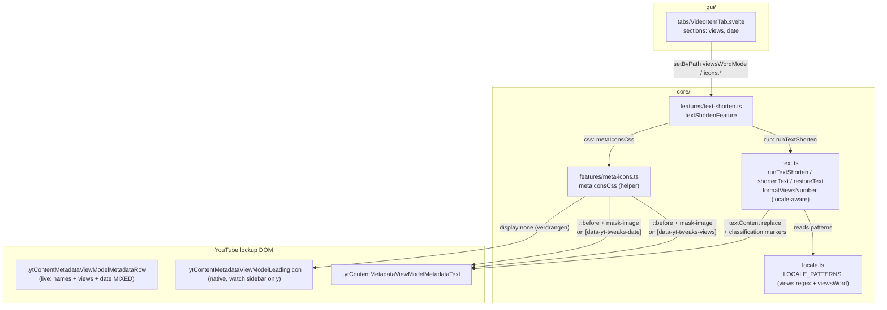
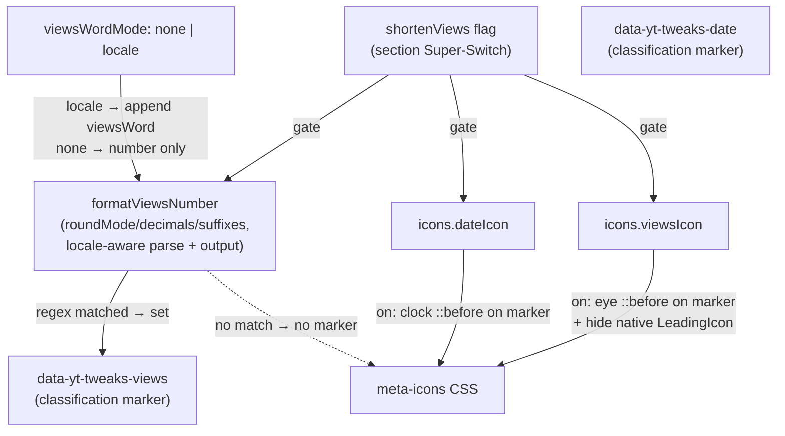

# text-shorten — Architecture

View-count + relative-date shortening (DOM pass) and meta icons (eye/clock, pure CSS) for
lockup metadata on grid pages and the watch recommendation sidebar. Diagrams depict
relationships, structure, and boundaries — no implementation details.

## Component Structure



## Views Word Policy + Icon Gating



- `viewsWordMode` (ADR 0006) replaces the removed free-text `viewsText`: the word is
  per-locale data (`LOCALE_PATTERNS[locale].viewsWord` — de "Aufrufe", en "views"), the
  setting only chooses none/locale. The views regexes are ANCHORED (`^…$`) — the old
  unanchored pattern rewrote bare numbers inside date texts ("vor 17 Std." → "vor 17
  AufrufeStd.").
- **Locale-aware number handling** (content locale, threaded through `shortenText`):
  parsing follows the content locale — de reads `.` as grouping and `,` as decimal
  ("270.417" → 270417), en reads `,` as grouping and `.` as decimal ("294,234" → 294234);
  parsing with the wrong policy corrupts values ("1.5M" → "15M"). The formatted output's
  decimal separator is locale-aware too (de "1,2M", en "1.2M"). The en views unit accepts
  lowercase ("45k views"); the de unit set is "Mio."/"Tsd.". Fixed-value date regexes
  (`gestern`/`heute`/`yesterday`/`today`) are case-insensitive because the fixed-value
  lookup lowercases the trimmed text.
- Icon targeting is MARKER-DRIVEN (bug #11 fix): live rows mix channel names + views +
  date in ONE metadata row, and channel names can be plain text without `<a>` — every
  structural selector guess (delimiter scope, LastPart, link exclusion) painted icons on
  channel names. The text pass is the only reliable classifier: it sets
  `data-yt-tweaks-views`/`data-yt-tweaks-date` ONLY on texts its anchored regexes actually
  matched. The CSS selects those markers — it cannot over-match regardless of YT's row
  structure du jour. `restoreText` clears the markers (live-apply re-classifies fresh).
- Icon technique: `mask-image` with an inline SVG data-URI + `background-color:
currentColor` → inherits the meta text color, dark + light theme safe. Alignment constants
  (`ICON_GAP_EM`, `ICON_BASELINE_SHIFT_EM`) are exported tunables, adjusted during the POC
  stage, asserted by tests.
- Native leading icon (watch sidebar play SVG): hidden while the eye icon is active so the
  two never stack.

## Scope Boundaries

```mermaid
flowchart TB
  subgraph Supported["Supported (text-shorten)"]
    S1[Views shortening: round/truncate + decimals + suffixes - DOM pass]
    S2[Date shortening: per-unit suffix formats - DOM pass]
    S3[viewsWordMode none | locale - enum, ADR 0006]
    S4[Eye icon before views + clock icon before date - pure CSS]
    S5[Shared icon sizeEm presets (0.6-1.4)]
  end
  subgraph NotSupported["Deliberately not supported"]
    N1[Free-text word after number - removed, ADR 0006]
    N2[Per-icon sizes - one shared size keeps the row height stable]
    N3[Custom icon SVGs - fixed eye/clock set only]
  end
```

## References

- Feature: `src/lib/core/features/text-shorten.ts`
- Icon helper: `src/lib/core/features/meta-icons.ts`
- Text transform: `src/lib/core/text.ts`, patterns: `src/lib/core/locale.ts`
- Settings: `src/lib/core/settings.ts` (`TextShortenSettings`, migration `viewsText` → `viewsWordMode`)
- GUI: `src/lib/gui/tabs/VideoItemTab.svelte` (sections `views`, `date`)
- Tests: `src/lib/core/__tests__/meta-icons.test.ts`, `src/lib/core/__tests__/text.test.ts`,
  `src/lib/core/__tests__/text-shorten.fixture.test.ts`,
  `src/lib/core/__tests__/text-shorten-watch.fixture.test.ts`,
  `src/lib/core/__tests__/video-item-migration.test.ts`,
  `e2e/tests/text-shorten.spec.ts`
- Decision record: [ADR 0006 — preset enums over free-form CSS inputs](../adr/0006-preset-enums-over-freeform-css-inputs.md)
- DOM fixtures: `src/lib/core/__fixtures__/home-grid-item.fixture.html`,
  `src/lib/core/__fixtures__/watch-recommendations.fixture.html` (captured 2026-08-23)

Verified: 2026-10-24 — against `src/lib/core/features/text-shorten.ts`, `src/lib/core/features/meta-icons.ts`, `src/lib/core/text.ts`, `src/lib/core/locale.ts` @ working tree (re-verified after the locale-aware formatViewsNumber change: content-locale parse policy, locale-aware output decimal separator, lowercase en units, case-insensitive fixed-value date regexes; re-checked after the 2026-10-24 locale.ts adsText addition — views/date patterns and viewsWord unchanged by it; re-checked after the 2026-10-24 meta-split change: markers/patterns untouched — the split pass only CONSUMES the views marker, ordering documented in grid-styling.md; re-checked 2026-10-25 after the wording pass: the views/date Field wiring in VideoItemTab is unchanged — only the viewsIcon/dateIcon `desc` props were dropped and date/suffix i18n labels renamed („Abkürzung für …“); all settings paths and the icon gating model are untouched; re-checked 2026-10-25 after the ADR 0007 defaults change: DEFAULT_SETTINGS.textShorten.icons now ships viewsIcon/dateIcon true — mask-image CSS + marker gating unchanged; settings.ts comment-only re-pass, no behavior change)
