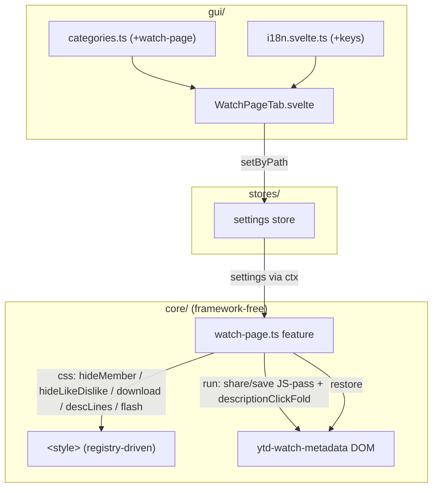
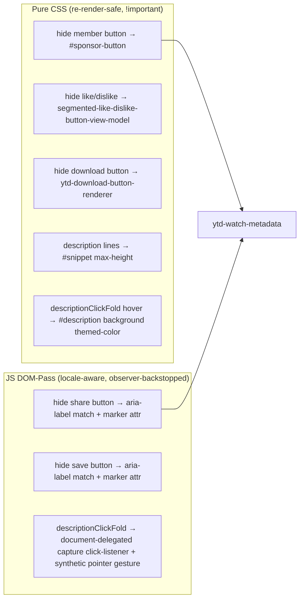
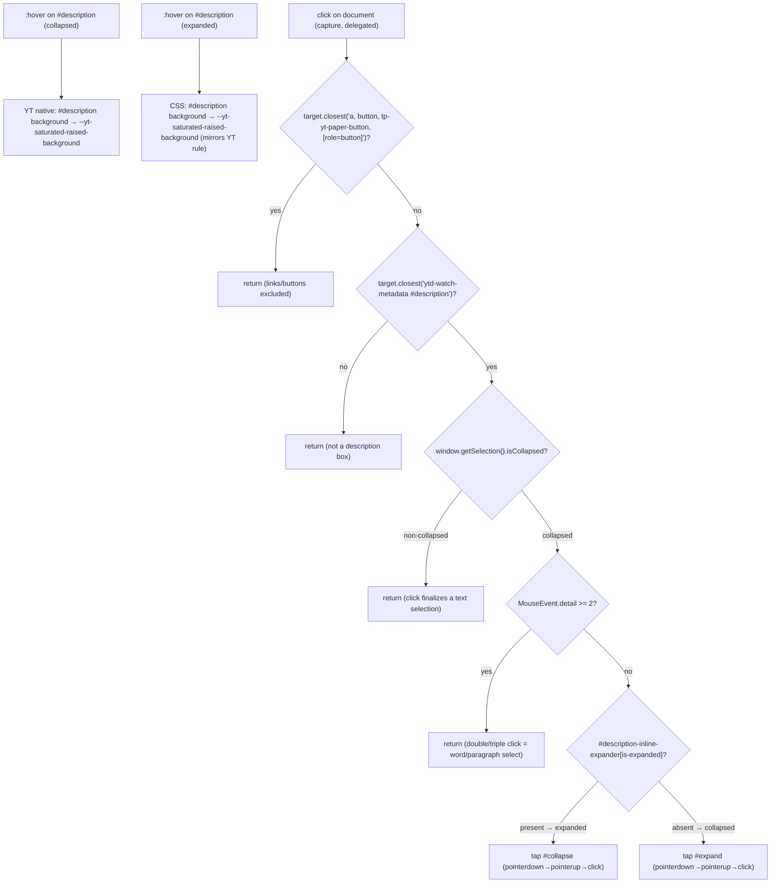
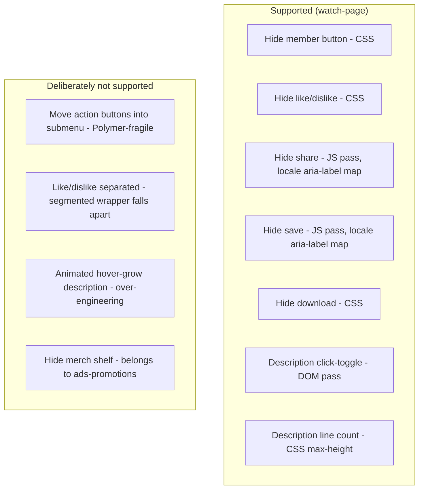
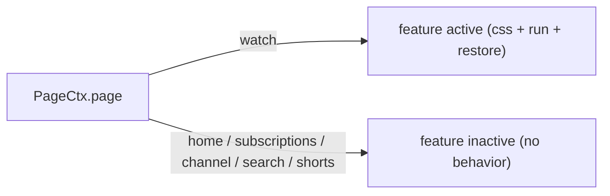

# Architecture: Watch-Page Feature

> Watch-page (`/watch`) layout tweaks for `ytd-watch-metadata`: hide member/like-
> dislike/download buttons (CSS), hide share/save buttons (locale-aware JS DOM pass),
> description click-to-fold (JS DOM pass), and collapsed-description line count (CSS).
> Watch-page only — `ytd-watch-metadata` exists solely on `/watch`. Diagrams depict
> relationships, structure, and boundaries — no implementation details.

## Component Structure



## CSS vs JS DOM-Pass Split



**Why split**: Share/Save buttons have no stable non-localized class — `aria-label`
is the only reliable anchor and it is locale-dependent. A JS pass sets a marker
attribute (`data-yt-tweaks-watch-hidden`) on the matching `yt-button-view-model`;
a CSS attribute-selector rule hides it. The marker (not inline style) is re-render-safe —
see [ADR 0001](../adr/0001-marker-attribute-over-inline-style.md). Download is a
language-independent custom element (`ytd-download-button-renderer`) → pure CSS suffices.
Member/Like/Dislike target stable custom-element/ID selectors → pure CSS.

## Locale-Aware Button Matching

```mermaid
flowchart LR
  Locale["ctx.locale (de/en/...)"]
  Locale -->|resolveLabels (fallback: de)| Labels["ACTION_LABELS[locale]"]
  Labels --> Share["share: [Teilen] / [Share]"]
  Labels --> Save["save: [Zu Playlist hinzufügen, Speichern] / [Save to playlist, Save]"]

  Share --> Scan1["scan #top-level-buttons-computed > yt-button-view-model"]
  Save --> Scan2["scan #flexible-item-buttons > yt-button-view-model"]

  Scan1 --> Match1{"button[aria-label] in share set?"}
  Match1 -->|yes| Hide1["set data-yt-tweaks-watch-hidden (CSS hides)"]
  Scan2 --> Match2{"button[aria-label] in save set?"}
  Match2 -->|yes| Hide2["set data-yt-tweaks-watch-hidden (CSS hides)"]
```

## Description Click-Fold



**Why synthetic pointer gesture**: `tp-yt-paper-button` uses Polymer's `on-tap`
gesture recognizer, which tracks `pointerdown`/`pointerup` — a bare `.click()` is
ignored. Dispatching all three events in sequence makes Polymer fire the toggle.

**Why document delegation**: A per-`#description` listener keyed off a marker
attribute was lost every time Polymer re-rendered `#description` (the marker and the
listener vanished together), leaving clicks dead in the expanded state until the
observer re-ran — an unreliable timing window. See
[ADR 0002](../adr/0002-document-delegation-over-element-listeners.md) for the full rationale.

**Hover highlight**: YT native only highlights the box when collapsed
(`ytd-watch-metadata[description-collapsed] #description:hover` sets the background to
`--yt-saturated-raised-background` — the per-video ambient/theme color, e.g. green or
red sampled from the thumbnail). The expanded box has no such rule, so we mirror it with
a `:not([description-collapsed]) #description:hover` variant reusing the same custom
property. The previous `yt-interaction .stroke/.fill opacity:1` approach showed the white
interaction overlay at full opacity and hid all text — replaced 2026-08-27.

**State detection**: uses `#description-inline-expander[is-expanded]` (present iff
expanded), confirmed reliable in the watch-page DOM — more robust than
`ytd-watch-metadata[description-collapsed]`.

**Text-selection guards** (2026-09-12, drag-select copy bug): a click that finalizes
a text selection also fired the toggle, so description text could never be
marked/copied. Two guards abort the toggle: (1) a non-collapsed
`window.getSelection()` — a drag-select still fires a click after mouseup;
(2) `MouseEvent.detail >= 2` — double/triple clicks select word/paragraph.
Selection state was chosen over tracking pointerdown position because it needs
no extra listeners and matches user intent (select-to-copy) directly.

**Idempotency**: a live `descFoldListener` ref makes re-install a no-op (observer re-runs).
**Restore**: removes the single `document` listener + clears the ref.

## Scope Boundaries



## References

- Feature: `src/lib/core/features/watch-page.ts`
- Settings: `src/lib/core/settings.ts`
- GUI: `src/lib/gui/tabs/WatchPageTab.svelte`
- Tests: `src/lib/core/__tests__/watch-page.test.ts`
- Decisions: [ADR 0001](../adr/0001-marker-attribute-over-inline-style.md), [ADR 0002](../adr/0002-document-delegation-over-element-listeners.md)

Verified: 2026-10-19 — against `src/lib/core/features/watch-page.ts` (ACTION_LABELS de/en, resolveLabels de fallback, `data-yt-tweaks-watch-hidden` marker, description click-fold guards), `src/lib/core/settings.ts`, `src/lib/gui/tabs/WatchPageTab.svelte` @ working tree (re-checked 2026-10-24 after the meta-split change: watch-page feature untouched; meta-split is grid-pages-only; re-checked 2026-10-25 after the ADR 0007 defaults change: DEFAULT_SETTINGS.watchPage now ships enabled true, hideMemberButton true, share/save/download "verstecken", descriptionClickFold true — DOM-pass + CSS logic unchanged; settings.ts comment-only re-pass, no behavior change)

## Page Scope



Watch-page only — no `"*"` fallback. The `ytd-watch-metadata` selectors target a
custom element that exists solely on `/watch`; emitting CSS or running the DOM pass
on other pages would be a no-op but wasteful, so the feature is scoped to `watch`.
